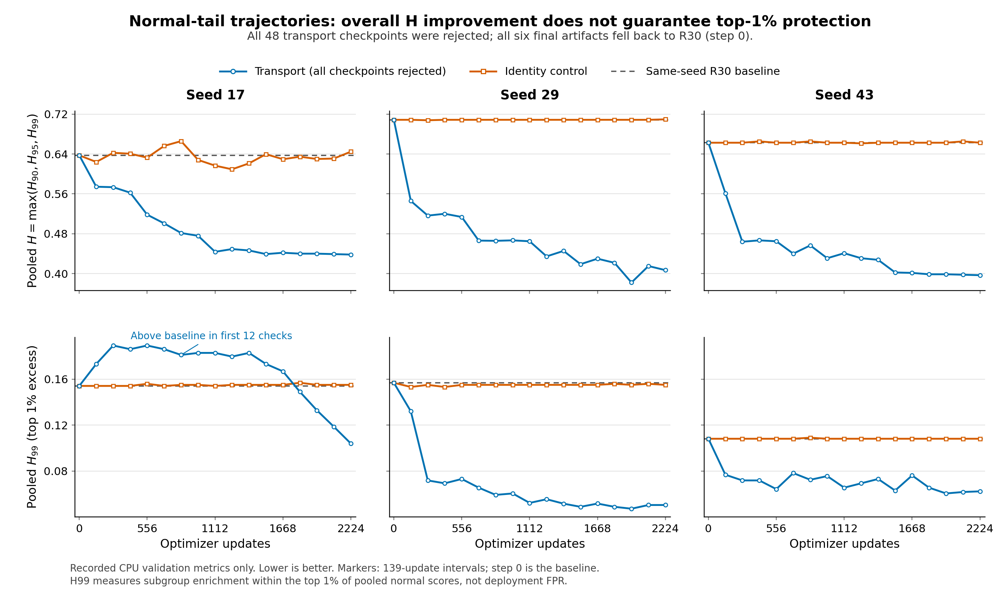

# R31 正常子群训练结果：执行有效，候选失败

2026-11-18。复核对象为实验室 `normal-subgroup-r31-v1-results.zip`，执行版本 `17dfdb5b492b7b3a03bb29fc1e83e7c9acfbc628`。本文件记录结果与后续处置；原设计、注册、源码快照和执行标签保持原样。

**这次训练没有完成正常子群误报修复。6 条轨迹完成了规定更新，但没有产生合格的改进模型，最终全部回退 R30。已有检出保住了，误报也原样保留。当前不需要再次去实验室运行这一方案。**

这不是一份运行故障包。数据、源码、随机流配对、更新数、选择记录和交付工件均与注册一致；没有发现足以解释失败的执行偏差。需要重新设计的是本项目增加的目标、保护和选轮关系，现有证据不支持归咎于 TabM 底座错误、GPU 不足或训练时间太短。

## 1. 回传有效性与最终效果

本轮完成 6 次拟合、每条 2,224 步，总计 13,344 次优化更新；每条 16 次验证，共 96 个检查点，P 重训为 0。96 个检查点来自连续训练，不能当成 96 次独立实验。

- 外层 `TraceLight-ALL-2026-11-18b.zip` 及两份 R31 内层 ZIP 的 SHA-256 均与随包校验文件一致。
- 训练包 387 个文件完整解包；正式 `--verify-only` 核验 386 份清单载荷通过。
- 207 份源码/配置绑定按登记的换行规范化口径，与回传快照、冻结 Git 标签逐项一致；注册与设计一致，16 份阶段收据有效。
- 三组配对的初始工件、预处理、F/V 身份、采样流、dropout 流、16 次验证步数一致。
- 运行于 RTX 4090 D、PyTorch 2.6.0+cu126；登记的依赖版本一致。

6 份 `selected_step` 均为 0，最终 `model.pt` 与同种子原 R30 工件逐字节相同。按物理身份对齐后，每模型 C 的 5,511 条分数及 E 的 17,059 条分数与 R30 逐位相同，判决差异为 0。运输目标臂与保持目标对照臂的最终结果相同：

| seed | B TP | D TP | B FP | D FP | 总 FP | 合规单元 | 单元正超额之和 X |
|---|---:|---:|---:|---:|---:|---:|---:|
| 17 | 72/72 | 1964/1964 | 55 | 99 | 154 | 8/15 | 25 |
| 29 | 72/72 | 1964/1964 | 65 | 110 | 175 | 5/15 | 37 |
| 43 | 72/72 | 1964/1964 | 65 | 137 | 202 | 4/15 | 66 |

每个模型相对 R30 的 TP 新增、TP 丢失、FP 新增、FP 移除均为 0。15 单元预算分别按正常分母取整，合计 143；不同单元的剩余预算不能互相抵消。原包 `adoption_pass=false`、`retained_development_arm=R30` 判定正确。保留 R30 表示保留开发参照，R30 本身仍未满足全部误报预算。

误报仍主要来自 TCP 正常：D 的 TCP/UDP FP 分别为 96/3、106/4、131/6。三种子的误报并集 333 条，共同误报 40 条；这些差异全部继承自 R30。完整 15 单元、协议分母和逐身份记录见[效果审计](normal_subgroup_results_20261118/effect_audit.md)。

## 2. 训练改变了什么，为什么没有候选入选

48 个运输目标检查点的正常尾部指标 H 都低于原模型，也都低于同种子、同一步的保持目标对照。目标对代理指标产生了作用，不能说模型完全没学到；但没有一个运输目标检查点同时通过全部保护条件。

| 运输目标 seed | 原 H | 记录中的最低 H（步） | H 改善 | 全保护通过 | 最高 1% 的 Hq 恶化 |
|---|---:|---|---:|---:|---:|
| 17 | 0.637351 | 0.438178（2224） | 16/16 | 0/16 | 12/16 |
| 29 | 0.708648 | 0.382061（1946） | 16/16 | 0/16 | 0/16 |
| 43 | 0.662667 | 0.396780（2224） | 16/16 | 0/16 | 0/16 |

唯一通过全部保护的是对照臂 seed29 的 step417；H 没有严格改善，因此仍不能入选。全保护通过与 H 严格改善的交集是 0。

最常见拒绝是 V 逐正例逆序数增加，发生 89/96 次。这里的逆序数指分数高于或等于该正例的 V 正常数量，增加不等于实际漏报。其他拒绝还包括 pooled pAUC 下降 38 次、各 Hq 保护失败 36 次、并列对数增加 36 次、来源内 Hq 保护失败 31 次；条件会共同失败，不能把次数相加。

只对已有记录做逻辑核对：即使仅去掉 V 逐正例保护，仍只有运输臂 seed17 的 step1807、2085，以及 seed43 的 step139 同时满足其余条件和 H 改善，共 3/96。seed29 仍为 0。这个计算没有重新选模型，也没有评价这些被拒模型的 C/E 效果。

- seed17 step1807、2085 分别有 12、9 个 V 正例逆序增加，幅度分别为 1–3、1–2；F 正例分数下降和逆序变差均为 0。
- seed43 step139 有 3 个 V 正例各增加 1 个逆序，其余保护通过。
- seed29 所有运输检查点的并列对数为 4,027–4,037，高于原值 4,020。step278 仅被这一项拒绝，H 从 0.708648 降至 0.516375；最大并列块仍为 84。

全部逆序变差的 V 正例均来自 B/UDP。被拒检查点未保存完整 V 正负逐行分数，无法确定是哪条正常跨过了正例、具体分数间隔如何变化，也不能把新增并列定位到操作尾部。这些缺失不能用重新训练补成原实验的证据。详细复算见[训练审计](normal_subgroup_results_20261118/training_audit.md)。

## 3. 模型与训练设计的问题

**训练保护与选择保护没有对应起来。** `losses.py` 在 F 上对正例分数下降施加有限权重、按来源平均的平方惩罚；`selection.py` 却要求 F/V 的每个正例正常逆序数都不增加。绝对分数软锚不保证相对排序，更不直接约束 V。即使正例分数不降，其他正常分数上升仍可增加逆序。seed17 的两个仅被 V 保护拒绝的点已经展示了这一差异：F 保护实现了，V 逐身份保护没有兑现。

单侧平方锚在分数等于原值时导数为零；成员 BCE、正常目标和 AdamW 权重衰减仍可改变共享参数。identity 对照也执行这些更新，并不是冻结模型。它用于隔离正常目标的净作用，不能因为它也失败，就推断任何微调都无法满足保护条件。

**主要改善指标没有直接对准 1% 操作区域。** 三个 step0 和全部 96 个检查点的 H 都由最高 10% 正常尾部主导，最高 1% 从未决定 H。seed17 有 12 个 H 改善点的最高 1% Hq 反而更差。代码已有逐 Hq 保护并正确拒绝这些点；设计缺口在于要求严格改善的主指标仍可完全由 10% 尾部贡献。

此外，H 衡量 V 中 A+B 正常在子群内的尾部集中度；正式阈值由 B 正常 C 校准，验收看 B/D 的 15 单元误报。即使最高 1% 的 Hq 改善，也不能直接推出这些单元在共同阈值下达标。上一版对这条联系给出的依据不足。

**并列保护的统计量与所防风险之间也缺少具体依据。** seed29 的并列对数仅增加 7–17，最大并列块始终为 84。这足以按注册拒绝候选，却不足以认定模型分数整体塌缩。当前资料没有新增并列的身份、尾部位置及判决影响，既不能把它说成塌缩，也不能看见增幅小就事后豁免。

这些是本项目设计的问题。此前实现、合成测试和零更新预检证明了公式、控制流与回放符合规格，**没有证明共享网络能够实现“正常尾部改善、逐身份保护、最终逐单元预算”三者的联合要求**。把工程实现完成表述成设计已经充分，是上一版就绪判断的不足。

## 4. 成熟作者实现支持的边界

继续保留已核验的 TabM+PLE 底座、成员 BCE、概率平均、原预处理及直接交付选中工件的流程。[TabM 固定作者实现](https://github.com/yandex-research/tabm/tree/28e47ae301c92ec37787dde1ce923a0793f405b4)支持模型底座、独立成员损失和分类概率平均；原预处理属于项目适配，选中工件交付遵循本项目冻结合同。当前没有发现需要更换主干或扩大模型的证据。

[MFSWB 固定作者实现](https://github.com/khainb/MFSWB/tree/fb5c3630841c0a02405a26233d92c5cd49f21668)提供排序分位和分组分布训练的计算参考。它没有验证本项目的单侧冻结目标、IDS 正例保护、H 选择规则及 1% 单元误报要求。作者源码参考不能替代本项目联合效果的依据。固定源码位置、哈希和适配边界见[设计解释复核](normal_subgroup_results_20261118/design_interpretation.md)及[原作者对照](normal_subgroup_design_20261118/alignment_proposal.md)。

## 5. 随包报告的更正

原报告作为回传原件保留，以下更正与其分开记录。

| 随包说法 | 复核结果 |
|---|---|
| 合同不可满足 | 只证实本次固定轨迹的 96 个检查点没有合格改进，没有证明参数空间中不存在解 |
| 守卫从未通过 | 对照 seed29 step417 全保护通过，但 H 未改善；完整入选条件从未同时满足 |
| 不是目标无效 | 目标改善了代理 H，完整方法未实现误报修复；不能排除目标本身的设计问题 |
| 正常压到零以下正好命中 D 误报 | F 原正常高于零本来只有 1、1、0 条；实际 C 阈值约为 −14.37、−12.54、−12.25。F 目标、训练后分数与 D 误报不是同一对象 |
| 梯度从未裁剪 | 运输 seed43 有 1 次裁剪，最大裁剪前范数 1.2984407；没有因此出现训练异常的证据 |
| F 有 15 个正例排序恶化 | 15 是绝对分数下降人数；真正逆序增加是 seed17 step139 的 5 个 A 正例，各增加 1 |
| B1 完整循环 98 次 | 98 是首个 139 步窗口的累计量；全程为 1,581 次完整循环，合计抽取 142,336 行次 |

## 6. 本轮处置与下一版必须完成的设计工作

关闭 R31 这份固定候选。保留 R30 全部检出工件及本轮负结果，不再次运行相同六轨迹，不通过延长训练、挑 seed、改阈值、模型拼接或事后放宽保护重新解释成功。当前分析没有发现需要立即修补的执行 bug，因此不修改冻结训练实现。

下一版须把最终要求、训练作用和选择规则写成同一条可核验的设计，具体修改范围如下；这不是新的实验注册。

| 对象及位置 | 要解决的设计问题 | 完成标准与退出条件 |
|---|---|---|
| 正常目标 `targets.py`、`losses.py` | 全分布拟合如何作用于真正决定低误报的正常尾部，而非主要改善宽尾部 | 给出目标、作者依据及与固定校准程序的联系；不能只用 H 或 loss 下降作依据。若仍无法解释 1% 区域和逐单元误报的关系，不登记训练 |
| 正例保护 `losses.py`、`selection.py` | 明确最终 TP 保留与 F/V 代理保护的关系，以及共享参数更新如何兼顾正常修复 | 每条保护必须说明所防失败、训练作用和验证对象；不能将“失败就回退”当作存在改善路径的证明，也不从本结果直接提出允许 k 条退化 |
| 主选轮及并列检查 `selection.py` | 主指标与操作区域对齐；区分有害尾部并列、重复输入和无判决影响的等分 | 完整规定比较次序和拒绝条件，使用可计算反例验证不会出现“宽尾部改善冒充目标改善”；不能事后重选本轮候选 |
| 训练诊断 `training.py` | 被拒点只有汇总，无法定位逆序和并列的具体来源 | 下一份获准运行的设计需预先约定保存逐检查点 F/V 身份分数及哈希，足以重建危险对和新增并列；不开 C/E 选轮，也不为补日志重跑 R31 |
| 独立验证与退出规格 | 已打开的 C/E 是开发材料，不能变成新方案的独立确认 | 新设计须区分开发验收与独立确认。原 B72/D1964 全身份保留、15 单元预算及三种子分别判断的要求不变；无机制依据时继续停在设计阶段 |

本轮已经定位直接拒绝原因，并证实目标—保护—验收之间的设计缺口；尚不能把原因细分到某个损失项、权重衰减或某一类正常身份。当前不发布下一次实验室运行命令。

## 7. 成本、复算和证据

六轨迹更新计时合计约 168.89 秒，轨迹总计时约 2,256.01 秒；后者还包含评分、序列化、I/O 等工作，不能把差值全部称为验证时间。最终模型仍为 416,704 参数、1,742,942 字节，CPU 单条 p95 为 1.725–1.796 ms，batch128 为 2,438–2,490 行/秒。六份部署判决一致性检查通过。由于工件都是原模型，这些是原模型的重复成本测量，不是新轻量化收益。

复核证据集中于 [normal_subgroup_results_20261118](normal_subgroup_results_20261118/README.md)：训练事件、效果单元、逐行误报、设计解释、来源/成本校验及可复算脚本。静态原件与完整回传位于项目 `实验归档/20261118_正常子群训练结果`，日常分析位于 `工作/正常子群结果分析_20261118`。

本次复核只读取已有工件字节、分数、判决和日志：新增模型加载、前向、拟合、阈值搜索均为 0。固定 C 序位复算用于核对原判决，没有产生新的运行点。

| 来源 | SHA-256 |
|---|---|
| 外层累计包 | `362465c947d46d0b327f3b52222f71dd031f6008b697fde3fdc4f4a418ee2b3c` |
| R31 训练包 | `8c90b6dd8f5eba4585fa8bdec15b7da95a05cfba959e5d93926389a805d4a70c` |
| R31 独立预检包 | `8e2b3fc63041ef9906ff0fe1f868db54f9e14eedf6d599ac90c0c6887c82d2eb` |
