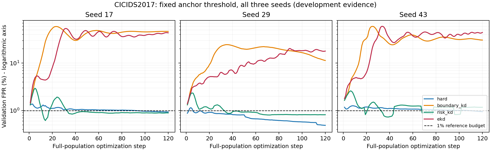

# risk-v3 完整回传复核：失败机制与下一轮改动依据

2026-11-04。本文复核实验室已完成的 v3 工件，不重训、不重新选择旧模型、不读取 calibration/test。下一轮算法依据应同时阅读[研究规范](RESEARCH_GROUNDING.md)和[近邻文献／作者项目审查](research_alignment_20261103/risk_v4_literature_audit.md)。

## 1. 工件身份与审查范围

两环境的源码提交均为 `fab38b52cb5271ad32034a655ccb1da472b61478`，运行记录 `dirty=false`。每环境27学生、12教师拟合、3锚点，共42次；两环境完整研究合计84次。pilot另计，不能把完整研究说成98次。

| 文件 | 完整 SHA-256 |
|---|---|
| `RISK_V3_UNSW.zip` | `cd11d9e87fac416e1a7d353afb3a6593370a12e81cdaf26217ab6b3046be6d38` |
| `RISK_V3_CICIDS.zip` | `7d41616e4665304a4ca36533a983369b89f5034fa8f428a1656ee7f77b112bca` |
| `RISK_V3_LAB_PREFLIGHT.json` | `7b54c853368c14f2608f2800a3cbfc717fcb7e3a46b7b90145716ea5218c3620` |

接收端已核外层清单及两内层包各223个载荷成员的哈希；第224个成员是包内清单自身。合格数为UNSW 12/27、CIC 16/27，与用户汇总一致。完成标记记录 `reserved_partitions_read=[]`；这表示运行记录及入口符合开发协议，不是对任意外部操作的安全审计证明。

逐步审查覆盖54个学生、6,480条宏步记录，重算事件计数、实际风险≤代理、历史合格标志、CPU状态与家族支持，未发现这批已覆盖检查的不一致。完整接收证据保存在本地忽略目录 `local/risk-v3-return-audit-20261103/`：`integrity.json`、`teacher_target_audit.json`、`family_review.json`、`family_review.md`、`kd_review.md`。原始包和封存模型保持原状。

## 2. CIC 正常目标退化已经从逐条 OOF 目标确认

v3 把教师预测概率转为float32，裁剪到 `[1e-6,1-1e-6]` 后取logit；再减去R工作点阈值，取sigmoid作为边界蒸馏目标。CIC三折的三个阈值在每个seed内全部重合，均为 `-13.815509796142576`。三个seed均发生同一退化。

| 环境 | seed | F正常行数 | 正常目标约等于0.5的比例 | 正常目标均值 |
|---|---:|---:|---:|---:|
| CIC | 17 | 657,512 | 99.631185% | 0.5009076 |
| CIC | 29 | 657,512 | 99.629817% | 0.5009270 |
| CIC | 43 | 657,512 | 99.634836% | 0.5008991 |
| UNSW | 17/29/43 | 27,440 | 0% | 0.0226708 |

“约等于0.5”采用已保存审计的绝对误差 `1e-12`；不是用粗糙四舍五入决定教师报警事件。CIC正常教师raw logit中位数为 `-13.815509796142578`，其R阈值只高一个float64 nextafter，因而极低原始预测分数被转换为近边界的软目标。UNSW没有相同现象。

对一个原来深负的正常学生logit，raw教师分数蒸馏可能继续把它向下推，而中心化目标0.5会把其工作点余量向0拉。这是与误报漂移一致的机制证据，但**不等于单独证明FPR必然达到50%**：独立可调正常logit的hard＋boundary BCE驻点仍在阈值下方；共享参数、攻击梯度及有限更新才可能造成大量越线。后续需要分项梯度范数、夹角、bias梯度和同初始化反事实运行。

EKD适配的教师rank-count为三个sigmoid之和。相同阈值下，多数正常目标接近1.5；学生深负时rank-count接近0，正常项约为 `0.3*(1.5)^2=0.675`，与首步soft记录0.670～0.672吻合。这说明该单行二元适配存在目标退化，不能推导原人脸配对EKD无效。

## 3. loss数值、梯度与工作点必须分开

CIC首步boundary soft为0.863～0.964，hard为0.003～0.017，不能直接把数值比解释为梯度比。boundary记录BCE，包含与学生无关的教师熵；换成同目标KL只减去常数，学生梯度不变。EKD在深负区也可能loss很大、sigmoid梯度很小。新实验必须记录分项梯度，不能用标量loss代替。

HGB在本仓实际使用 `compute_sample_weight('balanced', labels)`；教师输出不是未经重权、已校准的自然流量后验。学生hard的正类权重来自F+C，各折HGB权重来自该折训练部分。raw KL是必要简单控制，不自动证明概率已校准或类先验完全一致。

原包内描述性V重校准显示，boundary的TPR约0.99067～0.99275，hard约0.99281～0.99288。这个现象提示大量误报暴涨包含工作点漂移；**不能用V重校准来挽救或重新晋升旧模型**。下一轮应对各候选仅在R重校准，再在V评估，并同时保留原锚点冻结阈值下的兼容性指标。

另发现独立诊断精度问题：v3完整教师诊断仍可能以float32数组比较float64 nextafter阈值，NumPy将阈值舍回float32，使CIC完整教师V FPR被记为1。学生主路径已先转float64，不受这一处诊断问题影响；归档中的教师FPR=1不能直接当作教师无区分力的证据。应在新代码固定float64比较，原归档保留并标明受影响字段。

## 4. UNSW未达代理门槛，不等于实际家族检出损失超限

用户提到的“超0.03～0.07个百分点”具体对应UNSW `risk_kd` seed17最后诊断模型的**代理上界超限**：

| 攻击族 | C支持 | 代理超过1%预算的百分点 | 实际丢失锚点TP | 实际lost-TP质量 |
|---|---:|---:|---:|---:|
| Analysis | 288 | +0.025454 | 0 | 0% |
| DoS | 1,706 | +0.065449 | 0 | 0% |
| Exploits | 4,597 | +0.070032 | 8 | 0.174027% |

分母为该族全部攻击行，新增检出不能抵扣旧TP丢失。代理还惩罚硬判定翻转前的margin收缩，所以实际损失0也可能代理超限。

| UNSW seed | 满足共同C实际预算与V FPR的步数 | 满足代理与V全部门槛的步数 | 最近代理可行步（仅诊断） | 最近最大超额（百分点） |
|---|---:|---:|---:|---:|
| 17 | 77/120 | 0/120 | 63 | +0.009260 |
| 29 | 56/120 | 0/120 | 68 | +0.027377 |
| 43 | 8/120 | 0/120 | 117 | +0.062549 |

最近步是事后诊断，不能替换冻结选轮。seed43末步Analysis代理还超1.600316个百分点，不能把seed17的“差毫厘”推广至三seed。120步未通过固定代理，证明本配置未达到该门槛，不能证明可行域不存在、小样本必然导致不可行或对偶已收敛。

## 5. 合格率与约束机制的比较边界

v3的risk条件比hard/PCT/双源FD/EKD额外要求全部代理可行，故两类合格率不是同一判据。hard两环境没有任何一步满足全部代理预算；`normal_hinge_kd`虽按原协议两环境均0/3，但最后CPU实际C+V预算均3/3通过。保留原协议失败，另用共同实际事件准则诊断；不能只由合格率断言capped形式必要或uncapped形式失效。

CIC `risk_kd`轨迹V FPR峰值为2.957491%、2.353133%、2.594876%。它相对boundary/EKD的20%～60%峰值抑制了严重漂移，但没有给出每步≤1%的保证。最终乘子没有达到100上限，当前不能归因于乘子被截断。

纵轴为百分比的对数刻度，虚线为1%参考预算。图中保留全部三个seed和完整轨迹，未只显示选中检查点。

家族保护范围也有限：CIC的Portscan、Heartbleed、Infiltration在C支持为0，未被家族约束保护；139,618条训练Portscan全部在F，是整组分配结果。三种Web攻击C支持10/3/2，也未启用家族约束。Botnet仅88条，1%实际损失预算允许丢失0条；support≥30只表示满足预设启用规则，不表示统计充分。不得拆大组、反复换seed来制造完整覆盖。

## 6. 对下一轮的直接要求

1. 加入普通raw Bernoulli KL控制，teacher不减报警阈值；同时比较row mean与明确的二类均匀均值，记录改变的mixture及scale，不能称为新KD发明。
2. 在共同初始化和预算下保留legacy boundary/EKD以检验目标修正；所有候选同时报告冻结锚点阈值和仅R重校准的结果，不在V调阈值。
3. 区分实际事件预算与代理预算，记录代理间隙；如引入完整C上的post-AdamW接受／回退，hard也必须有同guard控制。有限C经验可行性不能升级为总体、漂移或未见组安全保证。
4. 若没有共同可行起点、更新全被拒绝或结果仅回退锚点，应明确记录，不能把“未更新”写成有益升级。保留全部seed、失败与成本。
5. 修正float32阈值比较诊断。所有新真实训练与正式资源测量继续由实验室RTX4090D执行；本机只做工件分析和单元／合成验证。

本轮支持的是失败机制与实验协议的修正，尚未支持新的准确率优势或算法新颖性结论。
