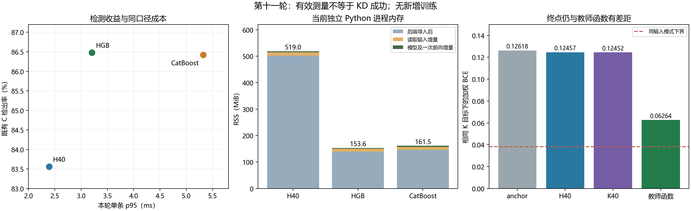

# 第十一轮 UNSW 零拟合诊断：验收与机制分析

分析日期：2026-11-06。依据：冻结标签 `lab-unsw-diagnostic-20261105`，提交 `b5f558561a741eab9154b44430ce2311eb3f2172`；本轮原始逐行分数、四个参数梯度、逐次成本与独立进程记录。三组代理分别复核有效性、F 机制和成本，主代理核对归档并汇总判断。

## 1. 判断与下一步

**本轮零拟合诊断有效，9项冻结有效性检查全部通过。第十轮普通KD候选仍然失败，本轮没有新增检测性能结果。**

这次确认：共同起点的hard与teacher梯度高度对齐，混合KD只小幅改变全F欧氏梯度；H40/K40实际终点仍明显没有接近已有教师函数的共同目标。它不支持“起点存在严重整体梯度对抗”，也不支持“学生已经充分学会教师，只是低FPR指标没体现”。优化可达性与学生表示限制仍未分离。

资源比较也有了实测依据：H40确实更快、模型包更小，但当前Python/PyTorch运行方式下完整进程内存更高。用户没有硬性部署上限，**HGB应作为主要实际参照，CatBoost和H40保留其各自取舍**；不能以约35KB本身证明学生方案更优。

**已有依据保留预先限定的H/K两臂优化方案对照，尚无依据扩大训练矩阵。** 学生的速度价值、终点拟合缺口和原优化方案差异，使这一竞争解释值得检验；它不意味着必须继续KD，也不意味着mini-batch必然提高检测。两臂没有在本次分析中启动，若后续执行，仍需另行冻结具体入口、排列清单和源码版本。

图中C检出率来自既有第八/十轮开发缓存，成本来自本轮；没有把本轮计时当成新检测评估。右图全部使用同一个K混合目标，不跨目标比较绝对BCE。

## 2. 解压与证据完整性

新增归档 `TraceLight-ALL-2026-11-06.zip` 为3,098,394,664字节。已核整包SHA，仅解压本次round11诊断包及相关说明，未重复展开旧轮次。

| 项目 | 结果 |
|---|---|
| 外层ZIP SHA256 | `0782fe6a5db60d0d7b40d722f0ac130aa77b902fa191d30abb6c49681f75232b` |
| 内层ZIP SHA256 | `13672655ccb44aab5fb1598c92b6c2d21f04e49bc43a5842eabd5feded983345` |
| 内层包 | 28,017,355字节；124份payload＋1份包清单 |
| 包清单、实验完成清单 | 124份payload、120份实验工件逐文件SHA通过 |
| 封存源码与提交 | 89份源码/配置与`b5f5585`逐字节一致 |
| 原输入 | 24份绑定工件、H/K初始日志和原train物理SHA通过 |
| F身份 | 85,916行，与原sample_id/feature_hash/标签/攻击族完全一致 |

实验室时间为北京时间2026-11-06 00:26左右，包名的20261105T16使用UTC，两者一致。详细记录见[完整性与预算复核](research_alignment_20261106/unsw_diagnostic_results/预算与有效性复核.md)及[归档核验](research_alignment_20261106/unsw_diagnostic_results/archive_integrity.json)。

## 3. 严格按原标准验收

| 项目 | 冻结预算/门槛 | 本轮复核 |
|---|---:|---:|
| 新教师/学生拟合、优化器更新 | 0/0/0 | 0/0/0 |
| 新教师F查询 | 0 | 0；CPU成本调用另计 |
| 三学生F前向 | 257,748行 | 257,748行，252次分块前向 |
| anchor反向 | 336次 | 84批×4，同一前向图复用 |
| CPU正式计时 | 450次、57,825行 | 完整一致 |
| CPU预热 | 30次、3,855行 | 完整一致 |
| RSS | 3个独立进程，各256行 | 3次、768行 |
| 旧V/calibration/test新评分 | 0 | 0 |
| anchor hard损失误差 | ≤1e-7 | 4.81125e-10 |
| anchor mixed损失误差 | ≤1e-7 | 4.99518e-10 |
| 梯度恒等式L2残差 | ≤1.10440e-6 | 2.33987e-8 |
| 三学生状态 | 前后不变且等于原绑定 | 全部通过 |

四个梯度均为6,625维且全部有限。三个学生损失均不低于对应同输入模式下界。每组CPU输入、执行位置和固定随机序列均重新核对，未挑块或追加计时。设备为RTX4090D、PyTorch2.6.0+cu126、CatBoost1.2.10；CPU流程固定4线程。

这是测量有效性验收，不是第十轮KD重新验收；本轮没有重测K成本，不能据H40/HGB成本改判旧K的1.25条件。

## 4. 教师优势没有转化为学生收益：本轮能确认什么

### 4.1 实际终点仍有明显拟合缺口

| 函数 | hard BCE | teacher KL | 相同K目标mixed BCE |
|---|---:|---:|---:|
| anchor | 0.125152425 | 0.040263043 | 0.126175216 |
| H40 | 0.123484752 | 0.038856974 | 0.124567914 |
| K40 | 0.123522069 | 0.038510705 | 0.124516711 |
| 已有教师预测 | 0.054639100 | 0 | 0.062642725 |

本轮测到了theta40实际终点，补上了旧训练日志仅到theta39的缺口。独立损失复算最大误差为6.80e-16。

K40相对H40的mixed BCE降低0.000051203、teacher KL降低0.000346269，同时hard BCE增加0.000037317。普通KD有可测的小幅目标作用，不应写成完全没有作用；但它只消除了起点到教师函数mixed BCE差距的**2.61048%**，H40已经消除了**2.52989%**。K40相对起点的teacher KL下降**4.35222%**。

K40仍比已有教师函数的同一目标高0.061873986；扣除同输入模式下界后的残差为0.086305520。教师函数在F上更好是实际证据，但它能否由当前small表示、能否沿当前优化路径到达，仍是两个不同问题。

### 4.2 起点整体梯度对抗没有得到支持

定义$g_H$为hard BCE梯度、$g_Q$为teacher KL梯度、$g_K$为混合梯度：

$$
g_K=\frac{g_H+0.3g_Q}{1.3},\qquad g_K-g_H=\frac{3}{13}(g_Q-g_H).
$$

| 起点几何量 | 复算结果 |
|---|---:|
| hard/teacher内积 | +0.009965001 |
| hard/teacher余弦 | 0.998321260 |
| hard/mixed余弦 | 0.999913418 |
| teacher−hard范数 | 0.006145309 |
| mixed−hard范数 | 0.001418147，为hard范数的1.40487% |
| mixed修正与hard的余弦 | −0.362529 |

各层hard/teacher余弦均不低于0.99036，没有发现被大层平均掩盖的明显反向冲突。84批只有1批hard/teacher余弦为负；全F主方向高度对齐。

小修正项的负投影不代表总teacher梯度在阻碍hard，也不代表修正没有有用信息。起点方向接近可以支持“当前局部KD修正较弱”，不能精确预测40步AdamW轨迹或C上+5 TP。逐坐标自适应缩放、后续参数点和低FPR阈值附近的错误交换都不由这一个余弦决定。

类别均值控制的KL梯度范数为0.457793、与hard余弦仅0.04438；实例教师与类别均值显然不等价。这也说明控制臂退步不能替代K超过hard的证据。

### 4.3 批间抵消保留优化解释，但不证明mini-batch必胜

全F梯度范数除以各批梯度范数之和，H为0.10877、teacher为0.20032、mixed为0.12182。这里有批间抵消，不能解释成“约88%的梯度被浪费”；比值依赖当前原顺序分块。

原warmup与续训都遍历40遍F，但分别有3,360与40次更新。结合本次终点拟合缺口，整体优化方案仍是有依据的竞争解释。本次未测终点参数梯度，不能拼接anchor梯度与终点loss宣布终点未收敛或容量不足。

### 4.4 软目标熵不是不可拟合噪声

$$
\mathrm{BCE}(r,p)=H(r)+\mathrm{KL}(r\Vert p).
$$

$H(r)$对学生参数是常数；当$p=r$时，KL已为0，但BCE仍等于熵。BCE不为0不代表软概率无法拟合。

| 目标 | 逐行目标熵 | 同输入模式最小BCE | 熵以外的最小KL冲突 |
|---|---:|---:|---:|
| H | 0 | 0.002899880 | 0.002899880 |
| K | 0.036818393 | 0.038211190 | 0.001392797 |
| M | 0.055528253 | 0.058179625 | 0.002651372 |

K/H下界比值约13倍，主要来自不同目标的熵常数，不能拿这个比值证明KD引入噪声或更差。同一完整输入模式的教师q其实相同；是重复标签可能让混合目标r不同。K扣除熵后的最小冲突还低于H。

逐族结果显示，K40超模式下界残差主要在Normal和Fuzzers；Reconnaissance的mixed BCE相对H40反而增加0.000031573。教师既有C检出优势在该族为+209 TP，当前配方没有自动承接这份优势，但F族loss与C低FPR检出不是可直接换算的量。完整逐族、分位及Adam代数说明见[F机制复核](research_alignment_20261106/unsw_diagnostic_results/F残差与梯度机制复核.md)。

## 5. 实际成本是否可接受

计时覆盖内存中的既有字段→预处理/原生转换→CPU模型→冻结阈值，不含磁盘读取、抓包和字段提取；每模型、每种尺寸的p95来自冻结C输入的75组测量。

| 模型 | 单条p95 ms | batch256 p95 ms | 批吞吐 行/秒 | 完整模型包 B | 前向后进程RSS MiB |
|---|---:|---:|---:|---:|---:|
| H40 | **2.39274** | **3.08600** | **91,758** | **34,549** | 518.992 |
| HGB | 3.20741 | 4.88469 | 57,948 | 1,509,420 | **153.629** |
| CatBoost-reference | 5.32301 | 5.80732 | 45,882 | 312,279 | 161.520 |

H40相对HGB单条p95低25.40%，批p95低36.82%，批吞吐高58.34%。两个尺寸各75/75组都保持H40更快，三块也同向，速度价值真实存在。

HGB单条p95多**0.81467 ms**，batch256多1.79869 ms。在已有开发C上，它相对H40多检出**488条**、少2条误报，TPR提高2.92093个百分点，漏报减少17.76%；R多检出213条、少11条误报。没有硬性资源限制时，这是一份有竞争力的检测—成本取舍。

必须保留错误交换：HGB在C救回733条、反向漏掉245条，R Analysis净少4条；CatBoost的R/C Analysis分别净少3/4条。因此HGB是主要参照，尚不是逐样本、逐族无损替换。

内存差异主要来自导入后端：H40导入后已约502.23 MiB，HGB约139.66 MiB。扣除输入加载后的基线，模型加载加一次前向仅增4.105/3.664/4.406 MiB。本次测量的是当前Python环境的独立进程快照，不是峰值或优化引擎；约35KB模型包不能替代完整运行内存。

HGB比CatBoost的两种尺寸推理都快、当前RSS更低，C多9 TP且R少11 FP；CatBoost包更小、R多40 TP且C少1 FP。保留这些取舍，不只按C总TP单项排名。完整分块、配对差及RSS基线见[成本复核](research_alignment_20261106/unsw_diagnostic_results/成本与收益复核.md)。

## 6. 对归档附带总结的修正

原始实验工件保留。`reports/UNSW-DIAGNOSTIC-SUMMARY-2026-11-06.md`是随包说明，其中以下解释不能沿用：

| 随包说明中的判断 | 本次复核 |
|---|---|
| “梯度99.83%同向，所以40步后只多5 TP是必然” | 0.9983是余弦，不是样本或坐标比例；起点局部几何不能推出多步低FPR结果 |
| “teacher−hard修正为0.001418” | 这是mixed−hard；teacher−hard为0.006145 |
| “软目标熵是任何学生无法拟合的噪声” | 熵是BCE常数项；单个软目标在p=r时KL为0，同输入冲突另计 |
| “K的BCE下界高13倍，所以KD更差” | 不同目标熵底线不同，不能跨目标直接判劣 |
| “三轮已证明差距唯一在函数类” | 现有证据未分离优化与表示，不能唯一归因 |

这不是否定本轮实验。测量本身有效，需纠正的是从测量到因果结论的推断。

## 7. 下一轮训练依据与停止条件

冻结规格中的前提现在有了实测支持：学生有稳定速度收益；F终点与教师函数仍有差距；整体优化方案是尚未排除的解释。因此，若下一步要继续研究教师为何未被承接，**可以只进入原先限定的H/K两臂mini-batch机制对照**。其目的应是检验目标与优化方案的交互，不能改称验证一种新KD方法。

- 教师、q、T=1、lambda=0.3、结构、起点、类权重不变；每臂40遍F、3,360更新，总6,873,280行带梯度前向、6,720更新。固定终点，不依据C选checkpoint。
- Kmini−Hmini至少+34条C TP，C pAUC不降；R净TP/pAUC不降，R/C误报预算、相对误报、逐族与集中度条件全部满足。
- 若主张达到预设优化交互，扣掉原full差值+5后仍须≥34，即mini差至少+39。不能将“超过34”直接当成交互验收通过。
- 失败就停止这一解释的训练投入，不自动加seed、温度、架构或教师；通过也不等于在新优化方案下已经胜过尚未重做的S/M。

实际交付可继续优先比较现成HGB与CatBoost，不必等学生研究成功。后续主要检测改进仍须对强参照证明价值；独立泛化需未参与设计的新确认来源，旧V/test或已开发C重新划分不能承担这一角色。

## 8. 交付文件

- [预算与有效性复核](research_alignment_20261106/unsw_diagnostic_results/预算与有效性复核.md)／[完整数值](research_alignment_20261106/unsw_diagnostic_results/analysis_integrity.json)
- [F残差与梯度机制复核](research_alignment_20261106/unsw_diagnostic_results/F残差与梯度机制复核.md)／[完整数值](research_alignment_20261106/unsw_diagnostic_results/F_mechanism_recomputed.json)
- [成本与收益复核](research_alignment_20261106/unsw_diagnostic_results/成本与收益复核.md)／[完整数值](research_alignment_20261106/unsw_diagnostic_results/cost_reanalysis.json)

解压工件和三个独立复算脚本位于本地工作目录`UNSW零拟合诊断分析_20261106`。本次分析未加载模型推理、未新增计时、未训练；原封存协议与原始结果未改动。
