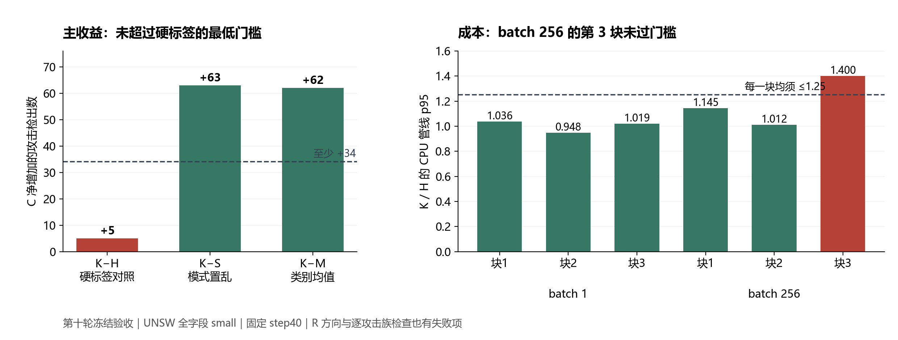

# UNSW 普通 KD 四臂实验：第十轮详细验收

日期：2026-11-05。冻结版本：lab-unsw-kd-20261105，提交 aa6221ad89dc81d5da3ad38a7587215b64bdbb2c。

## 1. 判断

**本轮完整、有效地执行了四臂实验，但普通 KD 候选没有通过冻结验收；没有依据进入下一轮训练。**

K 在 C 上达到对 S、M 的检出增益与 pAUC 门槛，却没有达到对硬标签 H 的最低实际增益；R 的总体与逐族方向检查也有失败，正式成本还有一块未过。不能将“胜过两个软目标对照”替换成“胜过三个对照”。

| 用户关心的问题 | 判断 | 主要依据 |
|---|---|---|
| 普通 KD 是否优于三个对照 | 未成立 | K−H 仅+5 C TP，要求至少+34；K−S为+63，K−M为+62 |
| 收益和代价是否可接受 | 未通过本次推进标准 | R净TP−1、pAUC略降、Analysis/DoS各−1；一块CPU p95比值1.400056＞1.25 |
| 是否进入下一轮训练 | 否 | 按冻结退出规则停止该候选，不追加seed、温度、权重、步数或教师 |
| 失败是否源于实验缺失或执行错误 | 未发现这类问题 | 清单、源码、目标、起点、四臂预算和数值训练均通过核查 |

这是对固定教师、原全字段 small 起点、T=1、lambda=0.3、40次全F更新的判断。它不把其他KD配方或学生函数类判为无效，也没有验证哪一种替代设计值得马上训练。

审查采用三个并行代理，分别核完整性、独立指标、成本与训练轨迹；主审再核已有教师分数与共同起点的对应关系。只读已保存工件，没有新训练、新模型推理、V/calibration/test数组读取或阈值调参。

## 2. 实验资格：通过

### 2.1 回传包和源码

| 项目 | 核查结果 |
|---|---|
| 外包 | TraceLight-ALL-2026-11-05b.zip；3,070,372,462字节，SHA与旁置文件一致 |
| 本轮内包 | UNSW_KD_20261105T0534199139380000-7ce490fc.zip；11,795,307字节 |
| 包级清单 | 127/127文件及文件集合一致；加清单自身为128个ZIP成员 |
| 实验完成清单 | 123/123文件及文件集合一致 |
| 源码 | 83份快照与固定提交的Git blob逐字节一致，记录dirty=False |
| 配置 | 冻结source配置字节一致；运行protocol副本解析后逐项一致 |
| 完成情况 | H/K/S/M完整，无FAILURE、缺臂、中断或追加条件 |
| 目标 | 原F缓存重建的q、置乱、均值、权重及四目标逐元素一致 |
| 共同起点 | 网络状态一致；step0的R/C分数与原warmup缓存逐元素一致 |

外包 SHA-256：

    91a85c124f43d8e1e297a08a5b94bcb6cddae15b61f05f52e1371f27a96c78df

内包 SHA-256：

    0c8c3e79d63aa76f7a06fa087fe1ba12f6802dc1982ba97106edc4a43f889c00

运行protocol副本的原始文件哈希与source配置不同，是JSON重新序列化产生的CRLF/LF和1e-8/1e-08文本差异；配置数值、结构和canonical哈希相同，不能误判为参数漂移。

原prepared的train.parquet未随包回传。本地复核了封存preflight、manifest、F/R/C身份及实际执行源码；原train物理文件的训练前哈希检查由成功preflight记录支持。本次外包未带单独的预检ZIP，正式实验包中的preflight.json完整，这不影响正式四臂工件的验收。

### 2.2 数据、控制与预算

| 分区 | 总行数 | 正常 | 攻击 |
|---|---:|---:|---:|
| F | 85,916 | 27,440 | 58,476 |
| R | 12,274 | 3,920 | 8,354 |
| C | 24,547 | 7,840 | 16,707 |

三份身份parquet与冻结源原始SHA相同，样本顺序、标签、特征组及分区互斥均通过。学生保持42个原始字段、189个编码维、[32,16]隐层、6,625参数，预处理未改变。

S严格使用预先固定的模式计数向量分层循环置换，实际改变82,045行目标，占F的95.4944%。正常/攻击的可交换行覆盖98.8047%/95.4716%，软化质量覆盖97.9533%/98.4866%，均超过90%门槛；每类q的完整分布及同模式同q不变量均保持。M按F硬标签类别取教师概率均值。没有根据C重新选置换或调软化强度。

执行设备为CUDA0 NVIDIA GeForce RTX4090 D；锁定依赖、AdamW设置、float32网络/float64损失、关闭AMP/TF32及线程配置一致。

| 预算项 | 冻结值 | 实际值 |
|---|---:|---:|
| 新教师拟合 | 0 | 0 |
| 新warmup拟合 | 0 | 0 |
| 学生续训 | 4 | 4 |
| 每臂更新 | 40 | 40 |
| AdamW更新总数 | 160 | 160 |
| 带梯度前向行数 | 13,746,560 | 13,746,560 |
| backward次数 | 6,720 | 6,720 |
| 共同step0＋四终点R/C评分行数 | 184,105 | 184,105 |

H也从共同起点完成了同预算续训；四臂均固定取第40步，没有根据逐步C表现选择终点。本轮只有一个共同起点。

## 3. 四个固定终点的实际表现

H为硬标签续训，K为真实KD，S为固定模式置乱，M为类别均值软化。TPR/FPR以下用百分数表示；pAUC列为max_fpr=0.01的标准化pAUC原值。

### C：主比较分区

| 臂 | TP | FN | FP | TPR | FPR | 标准化pAUC |
|---|---:|---:|---:|---:|---:|---:|
| H | 13,960 | 2,747 | 78 | 83.557790% | 0.994898% | 0.8895398241 |
| K | 13,965 | 2,742 | 78 | 83.587718% | 0.994898% | 0.8896319763 |
| S | 13,902 | 2,805 | 78 | 83.210630% | 0.994898% | 0.8859765060 |
| M | 13,903 | 2,804 | 77 | 83.216616% | 0.982143% | 0.8805236855 |

### R：方向与代价检查

| 臂 | TP | FN | FP | TPR | FPR | 标准化pAUC |
|---|---:|---:|---:|---:|---:|---:|
| H | 7,032 | 1,322 | 39 | 84.175245% | 0.994898% | 0.8877776960 |
| K | 7,031 | 1,323 | 39 | 84.163275% | 0.994898% | 0.8877740132 |
| S | 7,005 | 1,349 | 38 | 83.852047% | 0.969388% | 0.8854576882 |
| M | 7,021 | 1,333 | 37 | 84.043572% | 0.943878% | 0.8768976433 |

正常预算是上限，不要求每臂恰好花完。S/M部分分区FP更少，不能写成“四臂误报完全一样”。

独立复算使用保存的原始float64分数重建正常分数次序统计量，执行nextafter和score≥tau，再以独立ROC积分及scikit-learn交叉核pAUC。计数、阈值、21项指标条件和六份逐行事件表均与归档结果一致。

工作点依旧是每臂自己的tau=max(tau_R0,tau_C0)。H由R控制，K/S/M由C控制，符合冻结协议。复算使用完整精度的阈值。

## 4. 三个主比较：只通过两个

| C主比较 | 救回FN | 新增FN | 净TP | TPR差（百分点） | pAUC差 | 净TP≥34且pAUC不降 |
|---|---:|---:|---:|---:|---:|---|
| K−H | 7 | 2 | **+5** | **+0.029928** | +0.0000921521 | **失败** |
| K−S | 98 | 35 | +63 | +0.377087 | +0.0036554702 | 通过 |
| K−M | 112 | 50 | +62 | +0.371102 | +0.0091082907 | 通过 |

K对H距离最低整数门槛还差29条攻击。其实际净增量仅为34条要求的14.7%。pAUC方向虽为正，也不能补偿TP门槛失败。

S相对H少58个C TP，M相对H少57个；因此：

- K−S的+63 = K−H的+5，加上H−S的+58。
- K−M的+62 = K−H的+5，加上H−M的+57。

这说明K对两个软目标控制的大部分差距对应S/M相对H的退步，而K相对硬标签的新增收益很小。两个控制仍有识别作用：真实实例对应优于该固定置乱，也优于匹配平均软化；它们不能替代hard控制。

K也没有在每项代价上支配M：C上K比M多1 FP；R上K比S/M分别多1/2 FP。冻结误报约束的参照是H，这些差异应报告，但不能事后新增“必须比M误报也少”的失败条件。

## 5. 错误代价与逐族检查

### 5.1 正常流量

K和H在R、C的全部正常样本上判定完全相同：修复FP=0，新增FP=0。两者均满足39/78的正常预算，本项通过。

K−S在C上修复5 FP、新增5 FP，净0；K−M在C上修复5 FP、新增6 FP，净+1。这些事件已分别保留，没有只报净数。

### 5.2 攻击族

下表使用每臂已登记的原阈值。支持数不会因比较模型改变。

| 攻击族 | R支持 | R H→K TP | R净差 | C支持 | C H→K TP | C净差 |
|---|---:|---:|---:|---:|---:|---:|
| Analysis | 151 | 116→115 | **−1** | 288 | 229→229 | 0 |
| Backdoor | 129 | 123→123 | 0 | 241 | 225→225 | 0 |
| DoS | 928 | 889→888 | **−1** | 1,706 | 1,622→1,622 | 0 |
| Exploits | 2,451 | 2,272→2,272 | 0 | 4,597 | 4,270→4,271 | +1 |
| Fuzzers | 1,217 | 316→317 | +1 | 2,579 | 612→614 | +2 |
| Generic | 2,704 | 2,688→2,688 | 0 | 5,680 | 5,656→5,657 | +1 |
| Reconnaissance | 694 | 574→574 | 0 | 1,452 | 1,222→1,223 | +1 |
| Shellcode | 74 | 50→50 | 0 | 154 | 115→115 | 0 |
| Worms | 6 | 4→4 | 0 | 10 | 9→9 | 0 |

R整体救回2条、新增漏报3条，净−1。其中Analysis和DoS各新增1 FN；Exploits有1救回、1新增FN；Fuzzers救回1条。两个族出现净损失，因此R逐族规则失败。

C整体救回7条、新增漏报2条，净+5；两条新增FN同属一个Fuzzers完整特征模式，该族另救回4条，净+2。C各族净TP都不下降，所以C逐族规则通过。不能将第九轮裁剪的“零新增FN”条件搬来重判本轮；本轮冻结的是族内净TP不降，并要求报告所有交换。

R的pAUC减少0.0000036828，幅度很小，不能称为严重性能崩溃。它仍明显超过1e-12数值容差，冻结规则要求不下降，所以这项必须判失败。

### 5.3 集中度

C中K−H的7条救回对应7个单行正贡献模式，每组贡献+1；两个新增FN属于一个负贡献模式。最大正收益模式贡献+1，固定原阈值删除它后，剩余净TP=5−1=+4，本项通过。

因此，本轮失败不是一个巨大重复模式虚增成绩。真正的问题是增量过小，并伴随R方向及族损失。

## 6. 训练是否真的生效

核查160条训练记录：loss和梯度均有限、没有clip触发，最大梯度范数约0.149715，远低于10。四个终点网络哈希互异，且每个模型的6,625个参数均相对anchor发生变化。不存在目标未生效、网络未更新或数值异常的证据。

下表是step40日志：它记录的是第40次更新前theta39的F损失，不是对最终theta40重新推理的损失。R/C主指标使用的仍是正确的更新后theta40终点。

| 臂 | 初始hard BCE | 最后记录hard BCE | 最后记录teacher KL | 教师熵常数项 | 最后记录混合BCE目标 |
|---|---:|---:|---:|---:|---:|
| H | 0.125152426 | 0.123504921 | — | 0 | 0.123504921 |
| K | 0.125152426 | 0.123539565 | 0.038532197 | 0.020612648 | 0.124535128 |
| S | 0.125152426 | 0.128486383 | 0.191801904 | 0.020612648 | 0.163710305 |
| M | 0.125152426 | 0.129506650 | 0.171991443 | 0.040849546 | 0.180160379 |

K的teacher KL从0.040263043降到0.038532197，hard BCE也降低，说明优化确实在起作用。S/M各自的混合目标也下降，但hard BCE上升；这与其低FPR表现下降一致，不支持“自己的训练损失降低就能提高检测”的假设。

对K/S/M有：

$$
L_{\mathrm{mixed}}
=\frac{L_{\mathrm{hard}}+0.3L_{\mathrm{KL}}}{1.3}
+\frac{0.3}{1.3}\sum_iw_iH(q_i).
$$

K/S/M的120条记录满足上述式；H的40条记录满足Lobjective=Lhard。按各臂对应恒等式核查全部160条记录，最大误差小于7.5e-16。M的教师熵常数约为K/S的两倍。更一般地，BCE(r,p)=H(r)+KL(r||p)，不同软目标改变了目标及其熵底线，不能把四臂绝对BCE高低直接排成教师价值或检测效果排名。K/S的目标边际和熵相同，这两者损失差仍可反映当前输入与目标的匹配难度；它也不能证明“所有教师信息都无效”。

H/K/S/M记录的训练总秒分别为7.728、2.542、2.570、2.566，合计15.406秒。H固定第一个运行，计时包含网络/优化器建立等过程，缺少分阶段时间；不能据此宣称KD训练加速约3倍，也不能确认差异全由某一种CUDA初始化开销导致。

## 7. 已有教师的检出优势是否迁移到学生

以下是补充解释，不改变冻结验收。只读取原HGB保存的R/C分数，核对缓存SHA和行身份，没有新增教师查询。

共同起点在C检出13,952条；H续训后为13,960，K为13,965。K对起点的+13里，H同预算续训已有+8，KD相对H的增量才是+5。不能把+13全部归因于教师信息。

原HGB在C为14,448 TP、76 FP。对本轮H终点，它能救回733条H漏报，也会损失245条H已检出攻击，净差+488。这里的488与前期对旧第25步hard的479不同，原因是参照工件不同，不是教师变化。

在733条“教师检出、当前H漏报”的攻击中，K检出3条，约0.41%。K相对H总共7条救回中，另外4条教师在其自己的登记工作点也漏报；K新增的2条FN则均为教师能检出的攻击。这是固定工作点的事件重叠：教师的开发集检出优势没有在本轮学生中广泛复现。教师的二元判定不能覆盖软目标或排序知识，因此0.41%不是“全部知识迁移率”，这组统计也不能单独识别因果知识传递。

K与H在C的24,547条记录中仅9条报警判定不同，R的12,274条中仅5条不同，正常样本全部同判定。与此同时权重和分数确实改变，故不能把检测结果相近解释为“模型其实没有训练”。

还需区分模型分数变化和工作点登记：K的7条C救回中3条原始logit上升、4条下降，但仍越过了K更低的登记阈值。它们是按冻结规则得到的有效终点差异，不能全部描述为“教师把攻击分数抬高”，也不能因此另换阈值挽救候选。

当前证据支持“该KD续训没有形成足够的低FPR增量”。容量限制、共同起点影响、全F BCE与尾部工作点目标不一致，仍是相互竞争的解释；四臂固定同一种学生，没有单独识别哪个是唯一原因。

## 8. 部署结构与正式成本

结构检查通过：四包均34,549字节，K/H=1.000，低于1.05上限；均为原42字段、189维、6,625参数和相同预处理，部署不携带教师。

成本按原始时长独立重算，使用NumPy线性分位数。冻结seed重建的样本ID、正常/攻击配比和H/K交错顺序全部一致，未发现错配输入。

| batch | 块 | H p95（ms） | K p95（ms） | K/H | ≤1.25 |
|---:|---:|---:|---:|---:|---|
| 1 | 1 | 2.20636 | 2.28656 | 1.036349 | 通过 |
| 1 | 2 | 2.35406 | 2.23192 | 0.948115 | 通过 |
| 1 | 3 | 2.26816 | 2.31138 | 1.019055 | 通过 |
| 256 | 1 | 2.70270 | 3.09328 | 1.144515 | 通过 |
| 256 | 2 | 2.91202 | 2.94754 | 1.012198 | 通过 |
| 256 | 3 | 2.86210 | 4.00710 | **1.400056** | **失败** |

冻结要求六块全部通过，因此成本失败。batch256第三块K的p95比H高约40.01%。

完整75次样本合并后，batch1 p95为H 2.29938ms、K 2.28392ms；batch256为H 2.85310ms、K 3.09742ms。合并比值约0.9933和1.0856，属于描述统计，不能替换预先冻结的逐块门槛。p50相近和同结构说明不能据此断言KD固有成本增加40%，但现有记录也不足以确认超标“只是噪声”。

即使另一次成本测量通过，K−H收益、R方向及R族损失仍失败。本轮没有必要为了取得一个通过的成本数字而重跑训练或改变聚合方式。

## 9. 冻结验收总表

| 项目 | 结果 | 依据 |
|---|---|---|
| 工件、配置、目标、起点与预算 | 通过 | 已完整独立核查 |
| C：K−H净TP≥34 | **失败** | +5 |
| C：K−H pAUC不降 | 通过 | +0.0000921521 |
| C：K−S净TP≥34且pAUC不降 | 通过 | +63；+0.0036554702 |
| C：K−M净TP≥34且pAUC不降 | 通过 | +62；+0.0091082907 |
| R：K−H净TP不降 | **失败** | −1 |
| R：K−H pAUC不降 | **失败** | −0.0000036828 |
| 四臂R/C误报预算 | 通过 | 均≤39/78 |
| K−H两分区净FP不增 | 通过 | 均0，正常判定完全一致 |
| R每个有支持攻击族净TP不降 | **失败** | Analysis−1、DoS−1 |
| C每个有支持攻击族净TP不降 | 通过 | 各族均≥0 |
| 去除最大正收益模式后仍净正 | 通过 | +4 |
| 结构与包体积 | 通过 | 相同参数/预处理，包比1 |
| 六块CPU p95比值均≤1.25 | **失败** | 一块1.400056 |

指标模块21项布尔中17项通过、4项失败；加上正式成本失败，完整推进条件不满足。通过项不能投票抵消必要条件失败。

## 10. 随包总结中需要纠正的解释

原附带总结的“停止本候选”决定正确，下列解释应修正。原文件保留，不覆盖。

| 原总结中的说法 | 复核后的表述 |
|---|---|
| 四臂误报都为0.995%，只有TP不同 | H/K相同；S的R、M的R/C误报更少 |
| S/M是坏目标，唯一有意义的对照是H | S/M仍分别检验实例对应和平均软化；三组对照缺一不可 |
| S/M损失较高，证明只有破坏、没有教师价值 | 各目标和熵底线不同，绝对BCE不能这样横排；K整体目标是0.124535，0.123540是其hard项 |
| 差距已证明是函数类，不是信息 | 本轮没有改变学生函数类，只证明该冻结KD续训未达推进门槛 |
| 成本超标确定只是噪声 | 可列为待证解释；当前记录不能确定原因，仍按原门槛失败 |
| H较慢确定是首次CUDA上下文，KD更快 | 固定顺序、总时间无阶段分解，不能据此作算法加速结论 |
| 下一轮改用中位数或合并p95即可 | 本次不改变规则；即使成本通过，独立的效果失败仍在 |
| 普通KD所有路径都可以结束 | 停止本冻结候选；不把单一起点和预算扩成所有KD方法的结论 |

## 11. 后续行动

1. 封存本轮四臂、完整负结果与复算报告；当前候选不替换H，不进入更多seed或训练。
2. 不因K胜过S/M、训练loss下降或教师仍有headroom，就追加温度、lambda、教师、步数或学生架构矩阵。
3. 不为本轮回改成本聚合规则；不重新挑checkpoint、移动阈值或重新划分已用数据。
4. 若以后重新提出设计，先明确一个能区分现有竞争解释的新假设，用已有F工件和源码寻找支持，再另立最小协议与预算。当前四臂数据尚不足以指定“换函数类”“加大KD权重”或“从头训练”为已证实改进方向。
5. C已反复开发使用，旧V/test已不承担新的独立确认；后续独立泛化结论需要未参与设计的新来源，增加优化seed不能代替它。

## 12. 交付文件

完整分析目录为 `E:\OneDrive - Coventry University\中传\毕业论文\工作\UNSW四臂验收_20261105`；仓库另保存[紧凑复算记录](research_alignment_20261105/unsw_kd_results/README.md)。本地相关证据按以下目录保存：

- integrity/：外包、内包、源代码、配置、目标、起点和执行清单的复算脚本、JSON与报告。
- outcomes/：独立阈值与pAUC复算、四臂逐族表、三组主比较、六份逐行事件CSV及完整特征组表。
- cost_training/：六块成本、150组配对时长、160步轨迹、模型元数据及复算报告。
- mechanism/：共同起点和原教师缓存的补充对照、K−H事件对应和分数统计。
- figures/：验收图的PNG与PDF。
- received/：从本次归档抽取的原包及只读分析副本。

原归档、冻结协议和算法源码未修改。本报告不安排新实验。
