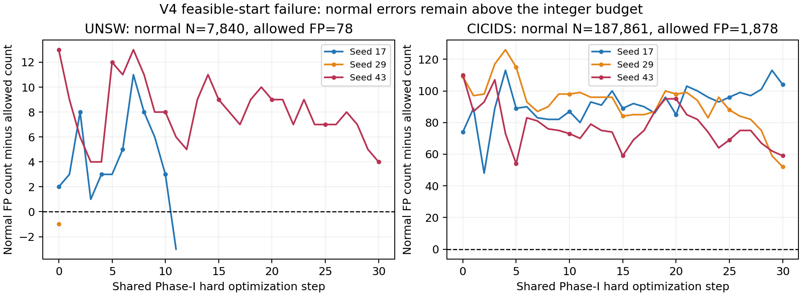

# v4回传复核：可行起点失败、确定性空转与有限阈值区间

2026-11-04。两环境回传包已按完整SHA、包内成员清单及完成标记验收；只做工件分析，没有在开发机运行真实训练。源码均为 `cee7527a4a8b11c82612ba1b923fdc9181cea708`、实验室RTX4090D、full三seed×八条件配置。

## 1. 流程完成与实际训练覆盖

| 环境 | 计划学生 | 实际训练 | 起点失败跳过 | 有效seed |
|---|---:|---:|---:|---|
| UNSW | 24 | 16 | 8 | 17、29 |
| CICIDS | 24 | 0 | 24 | 无 |
| 合计 | 48 | 16 | 32 | 不能称两环境三seed方法对照已全部执行 |

没有新教师／原始锚点拟合；共同Phase-I仍实际执行了131个hard宏步。UNSW种子17第11步得到C可行起点，29在step0可行，43执行30步仍失败。CIC三seed都执行30步Phase-I后失败，八种学生条件均未启动。因此本轮没有CIC的raw KD或guard效果证据，不能据此说它们已修复或未能修复CIC退化。

完整SHA：

| 工件 | SHA-256 |
|---|---|
| UPGRADE_V4_UNSW.zip | `e9398ea6b768434f8406bd91806fec2a7a8c9ba52de944fdbfa0bdb50f2eab73` |
| UPGRADE_V4_CICIDS.zip | `1671dbca27b5696960597b0a41745d18179b769c0cbd875f3ae7fd4283150648` |
| UPGRADE_V4_LAB_PREFLIGHT.json | `236ae6ecc7b1fccf4dd66bdb075c240af5e519bfa2c37a20255aee5bfad9861f` |

UNSW核验150个载荷成员、16份选中V预测共420,832行；CIC核验102个载荷成员。重算已保存raw logit判定、TP/FP与主指标均一致。UNSW976个学生状态及两环境137个Phase-I状态的整数预算、选轮、共同起点／跳过状态均按冻结协议核对。清单/入口记录 `reserved_partitions_read=[]`；不能将其扩大为对所有外部操作的安全审计。

旧v4没有随包保存C逐行分数，所以对C的这轮检查是记录内的整数／预算一致性，不冒称已独立重跑C分类。新评分审计会保存C分数及原基准mask，补齐接收端独立复算条件。

## 2. UNSW的KD增益很小，仍没有稳健胜出

以下均为两个成功起点seed上的条件化开发均值，第三seed的失败没有被删除或计为成功。各条件V实际误报不同，不能称同误报数下的净提升。

| 条件 | V TPR均值(%) | V FPR均值(%) | 选中step0 |
|---|---:|---:|---:|
| hard | 84.3984 | 0.9226 | 0/2 |
| legacy_boundary_kd | 84.2867 | 0.9464 | 0/2 |
| legacy_ekd | 84.2224 | 0.9167 | 2/2 |
| raw_kd | 84.4822 | 0.9464 | 0/2 |
| balanced_raw_kd | 84.4654 | 0.9583 | 0/2 |
| guarded_hard | 84.2420 | 0.9226 | 1/2 |
| guarded_raw_kd | 84.3034 | 0.9405 | 0/2 |
| guarded_balanced_raw_kd | 84.3956 | 0.9643 | 0/2 |

raw KD相对hard：seed17净多检出1条攻击，同时多1个FP；seed29净多29条，同时多3个FP。balanced KD分别净多6/18条攻击、多1/5个FP。raw平均只增加0.0838个百分点TPR；这些结果不足以证明稳定的软知识增益。legacy EKD两seed都选择共同step0，合格只说明保留了合格起点。

同seed逐行配对显示，raw KD的净增加来自“新增39/102条与丢失38/73条”相抵；不能把净TP差当作所有原攻击均受益。新方法的贡献仍须通过真正有信息量、同预算的控制及未使用来源确认。

## 3. guard全拒后进入确定性吸收态

六条guard轨迹只接受连续前缀；第一次全拒后，余下每一步的loss、完整提议、约束和V结果逐项完全相同。

| seed | guarded_hard接受/60 | guarded_raw接受/60 | guarded_balanced接受/60 |
|---|---:|---:|---:|
| 17 | 2 | 4 | 3 |
| 29 | 4 | 18 | 11 |

总接受42/360，剩余318次都是确定性重复拒绝。完整回滚参数、AdamW状态和RNG本身是正确的；但在相同全量梯度、学习率与回溯网格下，下一步提议不会改变。加长训练不能突破该状态。

P0修复已落实为首次全拒后停止，记录 `deterministic_guard_rejection`，保留本步评价与最优检查点；计划步数、实际尝试数分别记录。这个修改减少空转，不声称提高准确率。新的提议方向／学习率策略需另立控制，不能靠暗中保留被拒动量改变算法。

首步梯度也暴露目标冲突：UNSW raw KD的soft/hard梯度范数比分别约2.81/1.24，cosine约−0.879/−0.827；legacy EKD范数比约32.5/22.3，cosine约−0.766/−0.805。这是实际梯度证据，区别于v3的BCE标量熵常数。修好起点后才有必要研究固定小β、范数匹配及有原文依据的冲突控制，不能先以更多模块解释微小均值。

## 4. CIC起点失败只卡正常FPR

| CIC seed | step0 C正常FP | step30 C正常FP | 允许FP | 其他已启用实际约束 |
|---|---:|---:|---:|---|
| 17 | 1952 | 1982 | 1878/187,861 | 全程通过 |
| 29 | 1987 | 1930 | 1878/187,861 | 全程通过 |
| 43 | 1988 | 1937 | 1878/187,861 | 全程通过 |

93个状态中始终只有normal超限；Botnet等家族没有阻塞本轮Phase-I。UNSW seed43末步同样只卡正常FP82>78。用普通hard BCE推进30步，没有直接解决这些尾部计数要求。

## 5. 部分失败模型实际上存在可行阈值

v4固定选择候选R池允许1%FPR的最低阈值，再检查C；它没有搜索同一模型的其他合法阈值。

| 末步模型 | 本轮R阈值 | 冻结旧阈值 | 旧阈值下C正常FP | 旧阈值下全部C预算 |
|---|---:|---:|---:|---|
| UNSW seed43 | 1.46989119 | 1.50854146 | 77≤78 | 通过 |
| CIC seed29 | −2.96315765 | −2.71684361 | 1540≤1878 | 通过 |
| CIC seed43 | −4.74514532 | −4.30147076 | 1394≤1878 | 通过 |

三个旧阈值都高于对应R阈值；同一分数模型的报警集合随阈值升高只会缩小。因此旧阈值在R的报警集合是已合格R阈值报警集合的子集，**R预算也必通过**。结合C所有保留预算，现有metadata已足以证明这三个状态的联合R+C阈值可行域非空；不需要知道精确旧R计数。

这纠正了“R计数未知，所以无法证明存在性”的过度保守判断。它不追认v4原协议：v4预先固定了选择R最低阈值，旧失败结论保持。原包没有保存失败Phase-I模型，也无法凭JSON部署它；新代码已补齐成功／失败Phase-I检查点及SHA，旧包不改写。

精确可行域可通过次序统计求出：正常R/C预算给阈值下界（严格超过下一不可允许正常分数），原锚点TP保留给上界（允许损失后下一TP分数，含等号）。交集非空则有固定分数下的合法阈值；交集为空才说明这个分数模型无法同时满足这些有限池事件要求。推导、ties与来源见[研究审查](research_alignment_20261103/v4_next_research_20261104.md)。

## 6. 下一步先做零拟合评分审计

准备的实验室入口只查询已保存的v3锚点／hard与v4选中模型，计算R/C/V raw logits，保存R-only、旧阈值和精确R+C区间三种口径。**阈值只由R/C决定，V只评价。** 不新拟合教师／学生，不先重跑48条件；缺失的失败Phase-I检查点明确记无法恢复。

可运行步骤见[零拟合实验室指南](THRESHOLD_AUDIT_LAB.md)。

C参与选阈值意味着新的训练规则，不能称R-only校准或借独立校准定理宣称总体风险受控。现有v4结果保持原判据。若区间普遍非空，优先改阈值注册与共同起点；若区间为空，依据具体冲突族／正常尾部再做成熟CVaR-pAUC或可行化方向控制。若raw KD在这些同规则控制后仍无增益，撤回KD创新主张，保留更简单hard方案。

原数据已经多轮用于开发，不承担新主张独立确认。当前仍不支持新方法优于强基线、跨环境有效或创新性达标的结论。
