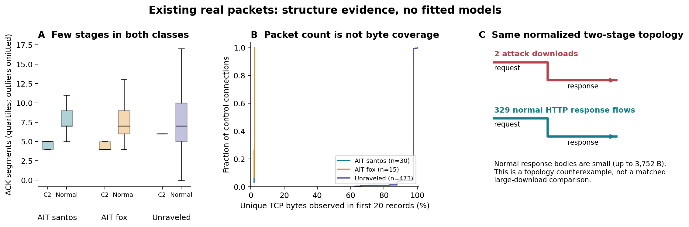

# 连接内部交互：真实包、机制推导与采用决定

2026-11-19。本轮把研究推进到原始 TCP 头部和可实现的学习算子，结论是：**ACK 先后关系没有建立独立的攻击判别依据；字节加权前缀算子存在精确的简单实现；查询压缩没有遇到真实的规模瓶颈。这三项均不进入新的训练批次。**

已有包信息仍可用于研究。当前尚未回答的是：保留完整连接的阶段结构，能否改善强简单方法在可比正常业务上的误报与目标攻击检出。这个问题需要区分新增输入的收益和算法改动的收益；本轮没有把其中任一项写成已经成立。

## 1. 实际完成了什么

- 从已有 AIT santos／fox 的 intranet_server、cloud_share，以及 Unraveled 目标主机，抽取 **4,961,557 条 IPv4 TCP 头部记录**。没有读取应用载荷内容。
- 沿用统一事件表与已有包—连接映射，完成 **8,514 条已开放目标连接、865,241 条唯一归属包记录**的字节与 ACK 表示。其中 7,645 条正常、520 条控制、2 条下载、336 条未知、11 条其他攻击；后两类没有转成正常。
- 正式展开“字节加权 ACK 前缀学习”和“查询保真压缩”的更新式、精确等价、误差界与退出理由。
- 对 26 条按来源、标签类别和固定 ID／最大包数选取的真实连接，验证相同 ACK 下细分包、重复重放保持规定的字节表示。变换后的记录仅用于表征检查，不增加真实样本量。
- 真实模型调用、拟合、阈值搜索均为零。已发布四臂、C、harrison、Meterpreter 保持原状。

事先口径见 [protocol.md](protocol.md)。逐连接结果在 [connection_geometry.jsonl.gz](connection_geometry.jsonl.gz)，活动与反例对应见 [relation_evidence.json](relation_evidence.json)，数值汇总见 [summary.json](summary.json)。

## 2. 攻击与可比正常业务显示了什么

以下控制连接均为 TCP/443。Unraveled 正常取控制活动开始至最后控制连接结束期间开始的同主机、同端口连接；AIT 两个短攻击区间内没有可信正常连接，因此列同场景、同主机服务的正常全体，不能称同时段匹配。

| 来源 | 控制／正常连接数 | 控制 ACK 合段数 | 正常 ACK 合段中位数 | 控制中可由普通方向字节块恢复的映射 |
|---|---:|---|---:|---:|
| AIT santos intranet | 30／125 | 4—5，中位数 5 | 7 | 12／30 |
| AIT fox intranet | 15／73 | 4—5，中位数 4 | 7 | 10／15 |
| Unraveled 同期 | 473／769 | 3—11，中位数 6 | 7 | 459／473 |

518 条控制均具备本轮定义的双向字节几何，没有观测到重复字节或载荷截断。Unraveled 同期正常 769 条中，749 条具备完整锚定、无已知缺口且归属无歧义的双向几何；正常中位数按表中全部连接计算。473 条控制来自同一攻击活动，不能解释为 473 次独立攻击复现。

**481／518 条控制的首见数据字节 ACK 前缀映射，可以由普通方向字节块精确恢复。** 这里没有重建纯 ACK 包、窗口、时间等其他属性，更没有恢复整个 FG-SAT 包图。余下 37 条含额外 ACK 差异；正常连接也存在这种差异，不能把“不能恢复”直接当恶意标记。

双向 ACK 覆盖量除以字节对总量得到的 K，在攻击和正常业务中普遍接近或等于 1。它说明请求、响应及累计确认在两类业务中都很常见。单个量饱和不证明所有包模型无效，也没有证明一个新关系模型有训练价值。

### 下载的真实反例与仍保留的候选

两条确认恶意下载的唯一字节量分别为 `[152, 139921801]`、`[150, 139921803]`，均可表示成单请求段后接单响应段。已有 Unraveled 中 **329 条作者标注整连接正常、GET 返回 200 且有正响应体的连接**，具有完全相同的归一化 ACK 两阶段拓扑。

这是“这种拓扑专属于恶意”的真实反例。329 条正常响应体最大为 3,752 字节，远小于约 139.9 MB 的恶意下载；它们没有完成等体积正常大文件对照，绝不能据此宣称已验证下载分类效果。

AIT 正常下载仍保留完整多候选证据：santos 44 个动作、375 个候选连接；fox 42 个动作、406 个候选连接。合计 781 个唯一候选中，671 个有整连接正常依据，110 个仍为未知。没有选择最大的连接替代真实下载对应，也没有将一个正常动作扩展成全部候选都是正常。

## 3. 找到的实际输入问题

FG-SAT 原文先取前 n 个包，再选择 n=20。依据为 IV-A（PDF 第 5 页）和 VII-G.1（第 12 页），见[作者托管原文](https://weihang-wang.github.io/papers/FG-SAT.pdf)。本轮按捕获记录顺序计算，不自行删除握手和纯 ACK。

| 对象 | 前 20 包覆盖的最终唯一有效载荷字节中位数 |
|---|---:|
| AIT santos 控制 | 2.2693% |
| AIT fox 控制 | 2.2679% |
| Unraveled 控制 | 97.8676% |
| 两条确认 AIT 下载 | 分别 0.0541%、0.0608% |

固定包数在不同来源中对应很不一样的业务进度。这不意味着同一连接上共同读取前 20 包的方法比较不公平。真正需要禁止的是：候选看到完整连接，近邻只看前 20 包，再把多看信息的收益说成新算法收益。当前项目仍按完整连接决策；若研究早期检测，应单独固定观测截止及可用字段。

采集形式也不能忽略。AIT 四源有 156,498 个 TCP 记录的声明载荷长度超过捕获；Unraveled 目标 TCP 中有 75,146 个 IP 长度超过 1,500 的记录。包计数不等于物理线上分段数。本轮分别保留声明字节、捕获字节和唯一序列字节，没有补造载荷。



图 A 为描述性分布；图 B 量化不同来源的截断覆盖；图 C 只比较归一化拓扑，不比较下载规模或分类效果。[可导出 PDF](packet_evidence.pdf)。

## 4. 相对近邻到底有没有算法创新

2025—2026 原始来源与实现核对见 [mechanism_neighbors.md](mechanism_neighbors.md)。FG-SAT 已经用 SEQ／ACK 建边；FSG-NID 已有方向流段图；C2Detector 已有交互状态和相邻块属性；FastFlow 已处理包序列、时间槽与等待决策。输入更多包、按方向成段、增加 ACK 边不构成新增机制。

本轮将候选写成明确更新：每个首见字节段从对向已确认前缀取得按字节质量加权的隐藏态，再经过共享 MLP 更新。逐层积分可以精确展开成“保留属性一致时合段＋前缀加权集合聚合”。**基础算子与这个简单控制精确等价，不值得为两种写法各训练一个模型。**

查询保真压缩也已推导到可实现程度：分箱对前缀读取的误差只来自包含查询点的箱；可给出紧界，并用动态规划选择边界。推导见 [design_alternatives.md](design_alternatives.md)。但真实控制仅 3—11 段、确认下载仅 2 段，项目也没有固定极小状态上限。现在采用压缩会主动制造近似误差，解决的是人为设定的困难。

上述结果分别支持输入规范化、代数等价和不采用压缩。它们没有产生新的检测算法，也不由 26 条变换检查推导检测收益。

## 5. 当前推进决定

1. **结束这三个具体主张**：ACK 有序程度可直接代表恶意；字节加权前缀积分本身是新学习机制；现有攻击需要查询驱动压缩。它们不保留为待调参训练臂。
2. **保留完整连接阶段表示作为同信息简单控制**。若以后采用包输入，强简单方法同步取得方向、唯一字节、ACK／阶段信息；已有普通合段先于新增复杂模块。所有方法使用共同原始记录和截止时刻。
3. **新机制的依据回到具体检测失败**：要解释在相同业务条件下，哪类正常误报或目标攻击遗漏不能被强简单方法吸收。当前四臂尚无真实回传，不能先编造它的失败模式，更不能用本轮结构描述代替模型结果。已有四臂结果按原固定规则一次解释，不自动扩展矩阵。

目前没有满足这些条件、可以提交实验室的新算法批次。当前研究产物是可复用包级输入、真实正反例、两个可实现候选的等价／退出证明，以及明确的比较口径；创新机制仍需建立。

## 6. 来源、实现与复算

来源路径、SHA 和公开材料身份见 [packet_sources.json](packet_sources.json)，采集与映射说明见 [packet_sources.md](packet_sources.md)，关联明细见 [source_association_check.json](source_association_check.json)。全部候选包均不晚于连接导出查询时刻；无歧义连接的双向包数及 IP 字节数与原 Zeek 一致。多候选包不强行分配，受影响连接保留记录并排除几何可用资格。

头部大文件留在工作目录 `连接内部交互研究_20261119/headers`，本提交保存紧凑结果、收据和脚本，不重新发布原始 PCAP 或论文全文。OpTC 没有可用原包，不从流日志反推 SEQ／ACK。

从仓库根目录复算已提取头部，PowerShell 命令如下（工作目录按实际位置修改）：

```powershell
$researchWork = 'E:/OneDrive - Coventry University/中传/毕业论文/工作'
$packetWork = Join-Path $researchWork '连接内部交互研究_20261119'
python scripts/packet_evidence/analyze_packets.py --headers "$packetWork/headers" --output "$packetWork/geometry"
python scripts/packet_evidence/relation_evidence.py --work "$researchWork" --geometry "$packetWork/geometry"
python scripts/packet_evidence/check_geometry.py
```

脚本不加载模型或执行分类决策。完整数据角色和四臂运行方式继续使用 [CURRENT_RESEARCH.md](../CURRENT_RESEARCH.md) 与[已冻结实验室批次](../COVERAGE_BATCH_LAB_20261119.md)。
