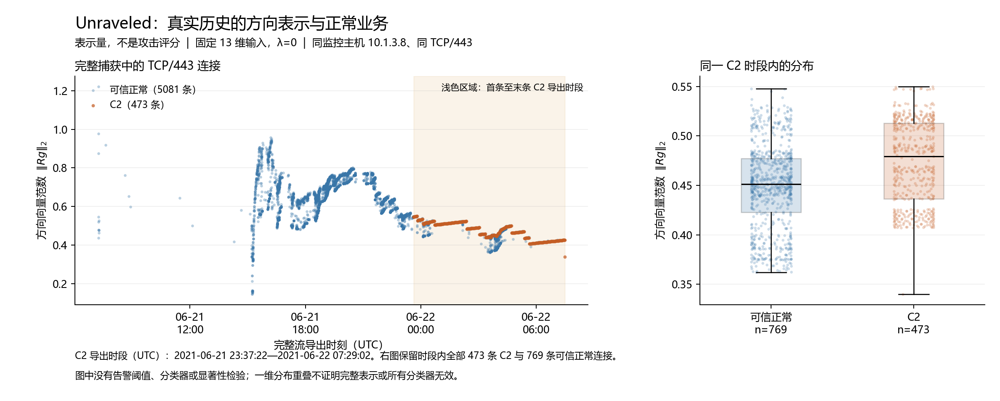

# 真实先后关系的结果与候选处置

2026-11-19。**现有真实材料没有建立当前“有向交互比例＋支撑”候选的独立判别依据，也没有建立相对同信息、同预算近邻的实质创新。本版本结束探索，不安排训练，不通过追加半衰期、门控或数据来源继续试跑。**

这项决定来自真实输入计算与具体正常反例。它不等于证明所有时序模型无效，也不是一次训练失败：本轮没有拟合分类器、计算模型分数或搜索阈值。

## 1. 实际计算了什么

使用现有 santos、fox、OpTC 已声明轮转和 Unraveled 捕获，按原来源组与监控主机重放 **125,987 条背景观察、56,220 个查询**。查询含 547 条可信攻击、54,808 条可信正常和 865 条未知；未知参与已观察历史，不作为正常标签。C 校准和 harrison／Meterpreter 保留材料未参与分析。

采用上轮的 13 维输入，五项 log1p 数值按 F_expanded 的正值中位数定尺度，缺失标记与协议分列。本轮固定无衰减完整前缀，未搜索窗口或半衰期。所有查询只读严格早于自己的历史，同刻整批查询之后再更新。完整口径见[计算前写定的协议](protocol.md)。

同时递推候选 P/A/S 与精确近邻 P/非对角 B。**所有真实查询都能由近邻重建候选的三个读取分支，最大绝对差仅 6.456×10⁻¹⁴。** 两种状态均为 169 个数，按 FP32 加 FP64 时钟计算为每实体 684 字节。实际计算用 float64 核对代数；这里没有资源实测或性能排名。

## 2. 哪些真实先后关系有证据，哪些能区分恶意仍无证据

| 来源 | 真实材料与结果 | 对机制的含义 |
|---|---|---|
| AIT 同主机 HTTPS | santos 30 条、fox 15 条确证控制；同主机同 TCP/443 分别有 125、73 条可信正常页面连接 | 可比较服务层面的观察，但正常查询没有覆盖两个攻击短时段，客户端也完全分离 |
| AIT 攻击后的正常业务 | 18＋21 条正常 HTTPS 查询均继承此前全部 30／15 条 HTTPS 控制 | 控制历史的存在不能决定当前恶意；候选必须从当前查询或更具体关系中获得额外证据 |
| AIT 动作顺序 | 攻击命令 527/528、153/153 对全候选保序；正常页面的相邻动作也有 51/51、56/56 保序 | 真实顺序可以保留，但有顺序并非攻击特征 |
| AIT 下载 | 正常下载在 cloud_share，攻击下载在 intranet_server；四次真实 wget 完成控制流均未早于下载查询 | 不能把服务／观测位置差异当作恶意顺序，也不能把晚到触发流补入历史 |
| OpTC 控制 | 24 条 C2 恰是所声明主机轮转中最早结束的 24 条，前缀长度为 0—23；正常 TLS 来自另一日轮转 | 冷启动和轮转边界与攻击标签纠缠；该材料不能单独证明有用的方向模式 |
| Unraveled 同期同服务 | 473 条 C2 与同一攻击时段的 769 条可信正常 TCP/443 连接；这 769 条正常也都有此前 C2 历史 | 提供了本轮较强的真实正常反例。必须证明读取关系有用，不能用“看到 C2 历史”替代逐流判别 |

AIT 的两个 run 共用攻击脚本家族，473 条 Unraveled C2 属于一个 campaign；这些连接数不是独立攻击实施次数。OpTC 的 365 条主机背景已对原 1,553,112 行轮转重扫：筛选只使用主机身份，没有按标签或 PID 裁片，但它仍只是一个日志轮转，不是该主机完整长期历史。详见 [AIT 证据](ait_evidence.md)与 [OpTC／Unraveled 证据](optc_unraveled_evidence.md)。

## 3. 真实表示没有把上述混杂消除

### Unraveled：同一时段的正常与 C2 表示重叠

以下是方向向量 Rg 的欧氏范数，只是固定表示的描述量，不是攻击评分。

| 同主机、同 TCP/443、同攻击时段 | 数量 | 中位数 | 四分位区间 |
|---|---:|---:|---:|
| C2 | 473 | 0.4791 | 0.4363—0.5127 |
| 可信正常 | 769 | 0.4513 | 0.4230—0.4773 |

两者明显重叠；单个范数的重叠不能证明所有多维分类器不可分，但它没有支持一个攻击专属的方向强度解释。

进一步把每条 C2 与同一攻击时段、同主机同服务的最近正常查询配对，保留全部 473 对。使用固定基点分解：

`R_A g_A - R_N g_N = (R_A-R_N)g_A + R_N(g_A-g_N)`。

其中历史状态项范数中位数为 **0.000819**，当前查询项为 **0.006373**；在 **466/473 对**中，当前查询项较大。这个分解只把读取差异拆开，不是因果贡献或贡献比例，两项也可能相消。它提示：若直接把 Rg 的差异当成历史作用，很容易把当前流形态带来的差异算进去。

换为同一时段内当前输入最接近的正常连接，历史项变大，但正常匹配只有 10 个不同连接，时间差中位数约 −13,157 秒。若不限制攻击时段，匹配时间差中位数约 −40,142 秒。两种固定匹配都保留，不能挑一种有利结果：相近时刻的比较受当前形态影响，最相近形态的比较又跨越数小时的业务阶段。现有计算没有分离出可推广的攻击先后效应。



### AIT：方向差异主要伴随阶段变化，已知控制的影响有限

同 HTTPS 控制的方向范数中位数，santos 为 0.1541，fox 为 0.9007；攻击后正常则为 0.1515、0.6379。santos 的正常与攻击接近；fox 的差异伴随没有同时段正常对照的阶段变化。不能用一个 run 的分离代替跨 run 稳定性。

作为事后归因，删除前缀中已有可信正标签连接、保持当前查询不变，控制查询方向变化的最大坐标绝对值中位数分别为 0.00482、0.000422。这不是部署算法，也未删除未知背景中的潜在攻击。它说明 fox 的较大方向值并不能主要归因于那些已确证的前序控制连接。

六个 AIT 下载候选全部保留。两个 GitHub 动作各有两个连接候选，未选其中更有利的一条。删除已知攻击历史后，santos 三个候选方向最大变化为 0.00715—0.00809，fox 为 0.000597—0.000696；真实 wget 的完成流仍全部不可用。当前材料没有把这些数值差异对应到可比正常下载中的独立恶意关系。

### OpTC：大的方向量可以来自协议及缺失模式

已证恶意下载的方向向量中，“duration 缺失”“UDP”“其他协议”三个坐标均约 −0.985，占该方向向量平方范数的 **99.6692%**。它们对应查询前约 140 秒的两条单包 UDP/53 和一条 ICMP，三条记录的标签都未知；此前 24 条确证 C2 都是 TCP。

对照的 9/19 声明背景全部为 TCP 且 duration 完整；42 条可信正常 HTTP 对照的这三个方向通道及相应一阶支撑均为零。这三个通道是否出现，在一阶支撑 P 中已经可见，不需要二阶先后关系。因此，下载向量中的大值可以反映日志片段里少数协议／质量事件的先后位置，不能直接解释成控制导致下载的证据。[逐记录归因](optc_download_direction_attribution.json)保留精确 UID、原始行号与分量计算。

## 4. 相对同信息、同预算近邻，究竟还剩什么差异

有序二阶 B 与候选满足：

`A = B-Bᵀ`，`S = offdiag(B+Bᵀ)`，`B_ab = (S_ab+A_ab)/2`。

因此记忆更新、可用信息和持久状态成本都没有新增优势。当前查询读取 Rg 还会压缩信息：固定非零 g 时，13 维反对称矩阵的 78 个方向自由度最多读出 12 个独立组合。近邻分析给出了可实现序列的完整读取碰撞，不把它夸成任何真实攻击的必然漏报。

真正不同的是归一化和汇聚的顺序：

- 候选逐交互对先算 A_ab/S_ab，再按 g 汇总。
- 近邻先按 g 汇总 A、S，再相除，并匹配相同有效查询权重 G；其余支撑分支完全相同。

两者都输出 39 维，分类头可以保持完全相同。**候选实质上提高了低共现量关系的相对权重。** 它没有新增训练参数或状态，属于固定表示偏置；“弱支持关系值得提高权重”正是需要真实依据的假设。

真实读取的差异确实存在，但未表现为攻击专属信息：Unraveled C2 的两种方向读取最大坐标差中位数为 **0.01020**，同期正常为 **0.01341**，正常侧反而更大。OpTC 下载两种读取差仅约 **0.001195**。这些量不能直接排名检测性能；它们说明不能把“两个公式不同”或“对攻击输出发生变化”当成价值证明。

2025 年 EFM Signature 已有指数衰减有序积分，2026 年 LogSig-SSM 已有签名压缩与序列读出。已核原文及固定作者实现；部分流量近邻未取得全文，不据此声称排除了所有先例。本候选当前没有超过“成熟二阶统计上的固定归一化与查询汇聚”的可证创新内容。详见[同信息近邻与创新分析](nearest_neighbor_analysis.md)。

## 5. 当前决定与交付

本版本停止推进到训练。实质原因有三个：实际正常业务也共享所称历史，当前表示差异仍与查询形态、业务阶段或协议／缺失模式纠缠；新增读取没有信息或状态成本优势；低共现量关系应获更大权重的假设没有得到可信业务证据支持。

不为它补采新来源，不扫描半衰期，不叠学习门控，也不把它换名为新的历史模型。已登记四臂继续保持原内容与原用途，其结果不能自动重启本候选。这里关闭的是本次固定比例记忆方案的继续试跑依据；原始资料和真实结果全部保留，避免以后再从同一假设重新开始。

- [固定计算脚本](../../scripts/order_evidence/analyze_real_order.py)：现有输入重放、同信息重建、正常匹配、事后归因。
- [精确近邻实现](../../scripts/order_evidence/ordered_pair_neighbor.py)：同状态量、同输出维数的两种读取。
- [实际汇总](real_order_summary.json)、[全部匹配对](matched_normal_pairs.jsonl.gz)：含全部来源层、时间层、分母及数据 SHA。
- 56,220 行读取细节保存在工作目录 `真实先后关系核验_20261119/representation/query_representations.jsonl.gz`，未放入模型训练包。

复算命令只处理数据与表示：

```powershell
python scripts/order_evidence/analyze_real_order.py --work "现有工作材料根目录" --output "新的结果目录"
```
