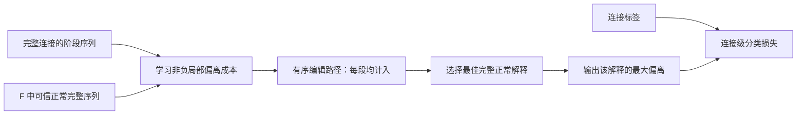

# 完整正常参照下的阶段偏离学习

> 后续决定：已完成[真实参照验证与缺口修复](../reference_evidence_20261119/index.md)。完整参照约束撤下当前创新主线定位，旧 null-gap 版本结束探索；新增无缺口实现仅作普通对照，不启动新训练。以下保留此前设计和原型记录。

2026-11-19。此次形成一个明确的候选学习机制，并完成数学与可变长原型：**用一条完整正常连接解释查询，学习哪些阶段偏离值得提高分数；与正常参考完全相同的完整表示，始终处于全局最低分。**

当前状态是设计与原型，不是已经证实的新检测算法。没有开启新训练，也没有运行真实模型前向。已有四臂不变；本机指定结果目录中未发现其完整回传，不能据此断言实验室尚未运行。

## 1. 这次设计针对什么

历史 R30 的具体问题是：部分正常业务有训练正常近邻，仍被整个模型排高。D 的三种子 TCP 误报中，88/96、93/106、114/131 条有 F_B 同四计数正常；其中 73、69、97 条的时长还在对应正常范围内。一种形态在 C 的 23/23、D 的 84/84 条均告警，F/C/D 分数中位数几乎不变。

这些事实支持研究“已有正常支持为什么没有落实到预测行为”。它们没有证明原因是阶段错配，也没有证明新设计能够修复这些旧误报。具体拥有工件及另一项跨传输排序失败见 [failure_basis.md](failure_basis.md)。旧测试结果只用于解释既有失败，没有重评或据此选择本候选参数。

本轮从上一轮包级表进一步核得：

| 事实 | 能支持什么 | 不能支持什么 |
|---|---|---|
| F 的 503 条 HTTPS 控制，其首段“方向＋唯一字节量”都在 F 正常段词表出现 | 不能把连接正标签直接当作该局部观测的恶意真值 | 不证明相同字节量具有相同载荷／应用语义，也不证明其完整上下文相同 |
| fox 的 15 条控制，前两段与 6 条同 intranet 正常连接精确相同 | 有实际共享前段，局部标注必须保留不确定性 | 不证明当前模型已经利用这些前段形成错误捷径 |
| 503 条中，没有一条的全部方向／字节段都出现在 F 正常词表 | 目前没有找到精确的“每段正常、整条恶意”实例 | 不能把合成的正常拼接反例冒充本项目真实失效 |
| F 有 6,840 条表示可用的正常 TCP 连接、2,797 种精确方向／字节序列 | 有可直接复用的正常参照候选 | 不保证覆盖新来源正常业务；正常身份、质量和数据角色仍分别保留 |

完整账本与连接 ID 见 [shared_stage_evidence.json](shared_stage_evidence.json)。其中 fox 已是开放开发材料，没有重新称独立确认；没有读取 C、harrison、Meterpreter，也没有把未知连接加入正常词表。

## 2. 模型如何作决定

输入是完整连接内、按捕获顺序累计的方向交互段，字节用首次观测的唯一 TCP 序列字节量。当前实物账本只有方向与字节量；没有把这些段命名为握手、命令或执行阶段。端点、端口、采集名称、绝对 SEQ／ACK 不进入比较器。

数值接口保留为 D 维阶段向量，最后一维是 presence：真实段为 1，空节点为 0。最小实物输入可以使用 `log1p(唯一字节量)` 加 presence；方向单独约束匹配。实际缩放、隐藏宽度和最终输入组合尚未登记为训练配置。合成原型的 D=3、H=8 仅用于验证实现，不是从真实结果挑出的模型。

设查询段为 q、正常参考段为 r，差值为 δ=q−r，定义：

\[
c_\theta(q,r)=\sum_k \delta_k^2\,\mathrm{softplus}(h_\theta([r,\delta])_k).
\]

共享小网络 h 学习不同正常参考附近，各方向的偏离应承担多大代价。使用带符号 δ，避免强制参考两侧的偏离完全等价。成本始终非负，自配恒为零；它可以不对称，也不要求满足距离的三角不等式。

对一条完整正常参考，采用保持顺序的编辑路径。相同方向允许匹配；插入和删除也必须分别计算 `c(q,null)`、`c(null,r)`。每个查询段和参考段都必须被消耗，至少有一次真实段匹配。先取一条路径中最大的局部代价，再取该参考的最佳路径，最后在正常参考中选最佳完整解释：

\[
S(X)=\min_{R\in\mathcal R_F}\min_{P\in\mathcal P(X,R)}\max_{e\in P}c_\theta(e).
\]



参考库只来自 F 内有整连接正常依据、满足该表示条件的真实连接。训练正常查询时排除自身及同一物理测量的别名；不能用自配零分掩盖学习问题。完全相同的方向／字节序列可以无损共享存储，但必须保留其所有身份，正确处理排除关系。不能机械排除整个 Unraveled 正常 observation_set，这会额外制造没有依据的跨来源条件。

训练只用连接标签，通过 `BCEWithLogits(αS−β,y)` 学习，其中 α>0。没有新造阶段标签，没有把攻击低分段转成正常。正连接推动当前最容易被正常解释的路径中仍存在的偏离；正常连接降低最佳完整解释中的最大偏离。硬 min/max 的梯度只经过活跃分支，优化会稀疏，这是需要验证的代价。

## 3. 已经证明的性质，以及一个关键修正

**正常精确锚成立。** 若库中存在与查询完全相同的完整表示，同方向对角路径所有成本为零，因此 S=0；其他输入 S≥0。模型冻结后，若校准阈值来自同样的非负分数，且判正使用严格大于，精确参考输入不会告警。

这个结论只覆盖完整表示精确相同。R30 的四计数相同、时长邻近，不等于完整阶段相同；不能把上面的性质说成已修复 R30，也不能将其推广到未知正常业务。

原先考虑过把自配固定为负常数，例如 −1。它并不够：若其他正常分数更低，校准阈值可能为 −2，自配 −1 仍会告警。因此本版使用全局非负成本和零下界，不再把“负分”误当低误报保证。

**完整解释与逐段解释不同。** 固定相同对齐时，若两条正常参考的阶段成本分别是 `[0,4]`、`[4,0]`，逐段任选参考得到 0，要求同一完整参考得到 4。代数上有 `max_stage min_reference ≤ min_reference max_stage`。

完整约束不会自动降低误报。它也会抬高未见的合法正常组合。可变长原型中的放松控制允许每个查询段独立选择兼容正常段或同一个 query-gap；它还放松了顺序、参考删除和完整覆盖，确实是候选分数的下界，但不能把所有差异仅归因于换参考这一个因素。

**空节点仍可能成为捷径。** 已实现的反例表明，即使至少匹配一次，模型仍能匹配共有首段，然后用低成本 gap 处理其余全部阶段。路径覆盖完整，不等于语义上解释充分；不能将路径的最大成本边直接命名为恶意报文。

## 4. 实质差异如何判断

近期原文、固定作者代码及具体机制见 [stage_neighbors.md](stage_neighbors.md)、[learning_mechanism.md](learning_mechanism.md)。

- [CEDAR，MobiHoc 2026](https://www.comm.utoronto.ca/~liang/publications/MobiHoc26_CEDAR.pdf) 已有多模态正常表示；正常多原型并非新增点。
- [PRADOT，2025 workshop](https://arxiv.org/html/2508.12927v1) 已有原型与 OT，固定实现推理时各 patch 独立选择原型。
- [EMS-uDTWAD，2026](https://www.techscience.com/cmc/v89n1/68431/html) 已将完整窗口与正常参考库匹配。普通完整序列最近邻、瓶颈 DTW／Fréchet 不能改名为新算法。
- [2025 流量 MIL](https://www.iccs-meeting.org/archive/iccs2025/papers/159040260.pdf) 和 [DSANet](https://ojs.aaai.org/index.php/AAAI/article/download/38191/42153) 已有弱标签聚合、正常背景相关机制。连接标签不扩散本身也不足以证明原创。

本版保留的是一组明确的学习约束：正常完整参考的全局零锚、针对参照的条件局部成本、完整解释约束及连接级监督。它们形成可执行、可被简单控制推翻的候选。当前没有证据证明这组约束已经优于近期方法，或已经构成项目最终创新。

后续必要比较应围绕三个问题，不能堆模型名单：

| 必要比较 | 回答的问题 | 不支持时的决定 |
|---|---|---|
| 固定局部距离＋相同完整编辑匹配 | 学习局部成本是否比普通模板匹配有效 | 采用简单匹配，不保留新增局部学习的贡献主张 |
| 同局部网络、同参照库的独立段放松控制 | 完整解释约束是否提供额外检出，代价是多少新增正常误报 | 去掉完整约束；不为它续加窗口、gap 比例或温度搜索 |
| 同完整阶段信息及正常参照信息的强简单模型 | 收益是否仅来自新增输入／正常支持 | 将结果归为输入改善，不写成新机制效果 |

所有对照都应获得同样的正常库和标签。预算同时计模型、参考存储、成本矩阵和路径搜索；三项是逻辑上的必要区分，**尚未登记为新增实验批次**。仅复制正标签到各段的弱模型不能成为唯一比较对象。

## 5. 原型与真实依据推进到了哪里

实现见 [reference_model.py](../../scripts/stage_design/reference_model.py)。它含非负条件成本、可变长瓶颈编辑 DP、最优参考／路径输出及同成本放松控制，没有数据加载器、训练循环或校准入口。

[合成检查](prototype_checks.json)验证了：

- 自配全局零值、非负成本、量词不交换，以及负常数锚失效的反例；
- 9 组小型编辑路径与穷举一致，包含插入／删除和必须至少一次匹配的条件；
- 活跃参数自动梯度约 −0.15980599137，有限差分约 −0.15980599133；
- 共有首段＋低成本 gap 的失败路径能够实际出现。

这些检查没有真实训练更新。当前实物证据只到阶段共用及参考支持规模，没有在真实连接上计算本候选分数、排名或性能。

完整参考库有成本。2,797 种精确序列合计 45,668 段，正常最长 1,220 段。一个 6 段查询若与全部精确序列直接计算，需 274,008 个配对位置；11 段查询为 502,348 个，另外还有 gap 与 DP。它们是由输入规模算出的运算位置数，不是时延测量。不能用攻击仅 3—11 段来忽略正常长尾，也不能只用原型的 85 个参数声称系统轻量。

## 6. 当前采用决定与接下来的依据

**保留这一个候选继续设计；不送实验室训练。** 保留的理由是其预测约束、监督和可变长实现已清楚，已有正常支持高分与阶段弱标签问题也有实据。尚未建立的是：真实任务确实需要完整解释约束，以及这项约束能在陌生正常业务上提供有用取舍。

接下来的依据必须来自强简单方法的实际失效，尤其区分总量／来源线索与阶段组合；四臂尚无本机完整回传，不能先编造它的错误身份。当前观察到 0 条精确的全阶段正常拼接控制，更不能宣称已证实一致解释必要。若其作用只在合成拼接里出现，就撤下这部分约束。

此设计也不承担全部协议的部署方案：当前阶段来自 TCP；无合法参考、表示不完整或没有原包的连接必须保留为未支持，不能当正常、不能当攻击、也不能从最终评价分母中悄悄删掉。完整系统如何处理这些对象，需在真正采用之前明确。

复算本轮已授权的本机工作：

```powershell
python scripts/stage_design/shared_stage_evidence.py --geometry docs/packet_interaction_20261119/connection_geometry.jsonl.gz --output shared_stage_evidence.json
python scripts/stage_design/check_prototype.py --output prototype_checks.json
```

第一条只统计已有表示的精确共有关系；第二条只使用人工小矩阵与数值向量。两者均不加载真实模型。
